# Vault Ventures Mobile App - Database Design

**Document:** 4 of 6 (Database Design)
**Edition:** 0.3-DRAFT (targeted consistency correction; preserves Editions 0.1 and 0.2 history)
**Status:** DRAFT. Not approved. Not development-ready. **It does not authorise development, and it does not authorise creating a database or running any migration.**
**Type:** Database DESIGN document. Table names, column names, types and indexes in this document are PROPOSED designs, not approved implementations. No database exists and nothing has been tested.
**Language note:** This file is ASCII-only by design.

---

## 0. Document control

### 0.1 Scope and exclusions
In scope: a relational MySQL design for the fresh database shared by the mobile app backend and the Web Admin backend operations: domains, entities, keys, constraints, indexes, security, transactions, migration strategy, release allocation, traceability and test criteria.
Excluded: executable SQL or migration files; ORM, query-builder or migration-library choice; MySQL version; hosting; backup tooling; endpoint design (Document 5); mobile or Web Admin UI; any legacy Laravel schema, code or data (G-01, OD-07); real payment, escrow, custody, card or bank storage.

### 0.2 Evidence labels
| Label | Meaning |
|---|---|
| APPROVED | Logged in Decision Register Revision 6. Exactly five: G-00, G-01 / DEC-046, OD-03, OD-07, OD-01 (approach only). |
| SOURCED | Required by Backend Functional Specification Edition 0.4-DRAFT, Admin Dashboard Specification Edition 0.3-DRAFT, corrected Mobile Specification internal Edition 2.2, or Decision Register Revision 6. A SOURCED entity still has PROPOSED physical shape. |
| PROPOSED | Design proposal of this document. Not a business rule. Not approved. |
| CONDITIONAL | Exists only if a named PENDING decision goes a certain way. Not built as if decided. |
| PENDING / UNKNOWN | Decision or information absent from all sources. Not guessed. |

### 0.3 Source hierarchy and files read
| Priority | File as supplied | Use |
|---|---|---|
| 1 | DECISIONS 2_REV6.md (Revision 6) | Current authority for approval and pending status. |
| 2 | Backend_Functional_Specification.md (Edition 0.4-DRAFT) | Active BE-* requirements, business-level data concepts, security boundaries, decisions and acceptance criteria. |
| 3 | Vault_Ventures_Mobile_Functional_Master_Specification_v2_1.md (internal Edition 2.2-DRAFT) | Active corrected mobile functional requirements, Business Roles and Unified Messaging context. |
| 4 | Admin_Dashboard_Specification.md (Edition 0.3-DRAFT) | Active AD-* requirements, Admin privacy boundaries, modules, workflows, audit and dependencies. |
| 5 | Any available roadmap | Historical/provisional planning context only; it cannot override the four sources above. |

MPS, ILS, P0-P9 and the UI/UX PRD were not independently re-read for this recovery edition; they reach it through the reconciled authoritative specifications. No legacy Laravel schema was supplied or used.

### 0.4 Approval hierarchy
If this document and Decision Register Revision 6 differ, Revision 6 governs. Exactly five decisions are approved: G-00 (Node.js + Express.js, MySQL, REST, JWT family, RN + Expo + TypeScript), G-01 / DEC-046 (legacy read-only; own repository), OD-03 (separate Web Admin; minimum Admin in R1; Admin never self-registered), OD-07 (no migration; fresh database; reference data defined anew), and OD-01 (approach only). G-07, G-10 / DEC-055, OD-10, DEC-010, DEC-042, BR-DEC-001..012 and MSG-DEC-001..013 remain PENDING; development is not authorised.

### 0.5 Assumptions
| ID | Assumption | If wrong |
|---|---|---|
| DA-01 | Release tags are PROPOSED and historically informed by Roadmap Edition 0.2; G-07, BR-DEC-012 and MSG-DEC-013 govern unresolved allocation. | Re-run Section 19. |
| DA-02 | One database serves both clients; only the Node.js backend connects to it (G-00, OD-03). | Section 16 changes. |
| DA-03 | Entity attributes follow Backend Specification Section 7 (business level); this document adds physical detail marked PROPOSED. | Catalogue revisions. |
| DA-04 | A verification tier belongs to the account, not to a role. | Move tier to account_roles. |
| DA-05 | Legacy audit statuses (IMP/PAR/UNV/MIS) prove nothing about this design (BE-GEN-018). | None. |

### 0.6 Terminology
Participant: Founder, Investor or Skilled Professional account. Admin: internally provisioned, never self-registered and never automatically a Business member. Account role: a global enrolled participant role. Business membership: an accepted, active relationship between a participant account and one Business. Business Role: a Business-scoped Finance Manager, Business Manager, Project Manager or restricted Custom Role assignment; title alone grants no action. Simulated: no real money, escrow, custody or legal effect. Append-only: rows are inserted and never updated or deleted by the application.

### 0.7 Database design conventions (all PROPOSED)
| Code | Convention |
|---|---|
| CV-01 | Engine InnoDB; character set utf8mb4. MySQL version is NOT approved (OD-06 / BE-DEC-09). Features used (JSON, generated columns, CHECK) must be confirmed against the chosen version. |
| CV-02 | Table names are lower snake_case plurals. This naming convention is PROPOSED, not approved. |
| CV-03 | PK: id BIGINT UNSIGNED NOT NULL AUTO_INCREMENT (surrogate). Link tables with no payload use a composite PK of their two FK columns (marked "composite PK"). |
| CV-04 | PID: public_id CHAR(36) NOT NULL UNIQUE on entities addressed from outside the database; internal ids are not exposed. |
| CV-05 | TS: created_at DATETIME(3) NOT NULL DEFAULT CURRENT_TIMESTAMP(3) plus updated_at DATETIME(3) NOT NULL DEFAULT CURRENT_TIMESTAMP(3) ON UPDATE CURRENT_TIMESTAMP(3). CT: created_at only (append-only or immutable rows). All timestamps are UTC. |
| CV-06 | MONEY = DECIMAL(18,2) in BDT. PCT = DECIMAL(5,2). Floating point is never used for money. Rounding rule PENDING (DEC-007). |
| CV-07 | Suffix "?" in the catalogue means NULL allowed; otherwise NOT NULL. "=x" is a default. Status and code columns are VARCHAR holding PROPOSED values; adding a value must not need a schema change. |
| CV-08 | Foreign keys: ON DELETE RESTRICT and ON UPDATE RESTRICT everywhere. No cascading deletes (Section 14). |
| CV-09 | Retention codes: RET-A = append-only or evidence; never deleted by application code; retention period PENDING (BE-DEC-14). RET-B = operational; deletion or anonymisation policy PENDING (DEC-026, BE-DEC-13). RET-C = ephemeral; expiry-based cleanup, interval PENDING. |
| CV-10 | Sensitivity classes: S1 internal; S2 personal data; S3 confidential business or financial data; S4 credentials, secrets or identity evidence. |
| CV-11 | Operational lifecycle rows use TS and permit only named state/revocation fields to change in controlled transactions; every such change appends audit/history. CT rows are fully immutable after insert. Re-grants/rejoins create new period rows rather than clearing revocation fields. |

### 0.8 Relationship to other documents
| Document | Relationship |
|---|---|
| 1 Backend Functional Specification | Source of requirements; its Section 7 entities are expanded here. |
| 2 Backend Development Roadmap | Phases and release rules; this design honours RR-09 and Section 4.4. |
| 3 Admin Dashboard Specification | Source of Admin data needs (Section 13 maps AD-MOD to entities). |
| 5 (API contract, per the owner's task statement) | Consumes Sections 4, 13, 17 and 20. No endpoint is defined here. |
| 6 (not defined by any supplied source) | Not assumed. |

### 0.9 Design-level conflicts and gaps (flagged, not silently resolved)
| ID | Item | Treatment |
|---|---|---|
| DBC-01 | Business and profile field lists are UNKNOWN (BE-BIZ-002, DEC-013 area). | Staged business content held as sections with JSON payloads (DB-E022); normalise only after approval. |
| DBC-02 | Negotiation term fields are undecided (CONF-06, DEC-006). | terms_payload JSON on negotiation_entries (DB-E042). |
| DBC-03 | Mandatory Admin approval before publishing is undecided (DEC-031, ADC-12). | Status is a free-valued column; approve/reject values and DB-E026 actions are CONDITIONAL. |
| DBC-04 | Escalation meaning is UNKNOWN (AD-DEC-01). | DB-E068 is CONDITIONAL, polymorphic target without FK. |
| DBC-05 | Saved opportunities have no defined entity or calculation (DEC-018, DEC-040). | DB-E065 and DB-E066 are R3 CONDITIONAL. |
| DBC-06 | JWT session storage is undecided (G-03, G-05, OD-08, OD-11). | DB-E005 CONDITIONAL; alternatives in Section 5.4. |
| DBC-07 | Active-role persistence undecided (G-06). | No active-role column in base design. |
| DBC-08 | Backend Spec says one report flow per report; duplicate flags are an edge case. | Unique key proposed; marked PENDING. |
| DBC-09 | Earlier deal-only messaging and Admin-read assumptions are obsolete. Backend 0.4 requires unified Hiring, Team and Deal conversations with no default Admin access. | DB-E045 is retained as the message entity but is re-scoped to conversations; no Admin participant or read path exists. Exceptional review/moderation remains PENDING (AD-DEC-03, MSG-DEC-011/012). |
| DBC-10 | NDA, Terms and disclaimer texts are not supplied (BC-15). | body_text nullable in DB-E007. |
| DBC-11 | Exact Business Role catalogue, permission merge rules, role administration, historical visibility and release allocation are unresolved. | Physical entities support explicit default-deny grants and revocation without selecting BR-DEC-001..012 options. |
| DBC-12 | Messaging categorisation, retention, attachments, receipts, presence, moderation, deletion, delivery technology and release allocation are unresolved. | Core conversation/access/message/read-state concepts are PROPOSED; optional capabilities are not modelled as approved. |

### 0.10 Revision history
| Edition | Change |
|---|---|
| 0.1-DRAFT | Original recovered complete design: 69 entities, sections 0-25 and deal-only DB-E045 messaging model. Historical content preserved. |
| 0.2-DRAFT | Reconciled Revision 6, Backend 0.4, Mobile internal 2.2 and Admin 0.3; added Business membership/permissions, Deal delegation, Unified Messaging, delegated milestone/report context, security, migrations and negative tests. No pending decision approved. |
| 0.3-DRAFT | Corrected migration dependency paths, financial-version immutability, revocation/update conventions and account/tier-scoped verification open-request uniqueness. No entity or decision status changed. |

---

## 1. Database architecture overview

### 1.1 Architecture (APPROVED parts and PROPOSED parts)
| ID | Statement | Label |
|---|---|---|
| DA-ARC-01 | The database is a fresh MySQL database; nothing from the legacy platform is imported (no migration). | APPROVED (G-00, OD-07) |
| DA-ARC-02 | The Node.js + Express.js backend is the only database client. The mobile app and the Web Admin never connect to the database. | APPROVED direction (G-00, OD-03); enforcement design PROPOSED |
| DA-ARC-03 | One shared database serves mobile and Web Admin operations; participants and Admins are separated by distinct account tables and server-side authorisation, not by separate databases. | PROPOSED |
| DA-ARC-04 | Environments (development, non-production test) use separate database instances with synthetic data; production data is never used for tests. | SOURCED (BE-GEN-016); instances PENDING (OD-06) |
| DA-ARC-05 | MySQL version, hosting, ORM, query builder, migration library and backup tooling are not selected. | PENDING |
| DA-ARC-06 | Referential integrity is enforced by foreign keys; rules that span tables or depend on state are enforced by server transactions (Section 14.7, Section 17). | PROPOSED |
| DA-ARC-07 | Every state change and its history or audit row are written in one transaction (BE-GEN-007, AD-ARC-010). | SOURCED requirement; mechanism PROPOSED |
| DA-ARC-08 | Operational logs (latency, errors) are not stored in this database; audit entries are (BE-GEN-012, AD-SEC-015). | SOURCED |
| DA-ARC-09 | R1 deployment contains no table of R2 or R3 (RR-09, Section 4.4); R2/R3 tables reference R1 tables only. | SOURCED rule; check in Section 19 |

### 1.2 Migration strategy (summary; detail in Section 18)
Forward-only, versioned, domain-ordered migrations authored after approval; R1 set separate from R2 and R3 sets; no legacy import; synthetic data only outside production. Tool choice PENDING.

### 1.3 Transaction and integrity responsibilities
| Concern | Database | Server |
|---|---|---|
| Keys, uniqueness, NOT NULL, simple CHECKs | Yes | Validates earlier |
| State-transition legality, cross-table rules (for example participant differs from owner) | Not fully | Yes (Section 14.7) |
| Authorisation, disclosure stage, tier gates, NDA gating | No (MySQL has no row-level security) | Yes (BE-GEN-002) |
| Append-only audit | Grants and optional triggers | Writes inside the same transaction |

---

## 2. Complete data domain inventory

Release tags are PROPOSED (Roadmap). Classes S1-S4 are defined in CV-10. "Unresolved" lists the main PENDING decisions.

| Dom | Domain | Source requirement IDs | Purpose | Rel | Entities | Ownership | Class | Unresolved |
|---|---|---|---|---|---|---|---|---|
| D01 | Participant accounts and credentials | BE-AUTH-001..014, BE-ROL, AD-USR-007 | Identity, login, status, tier | R1 | DB-E001, E004..E008 | Account owner; Admin reads limited | S2, S4 | G-03, G-04, G-05, DEC-016, BE-DEC-04 |
| D02 | Participant role enrolment | BE-USR-001..004, BE-ROL-005 | Multi-role accounts | R1 | DB-E002 | Account owner | S2 | DEC-005, G-06, BE-DEC-12 |
| D03 | Admin accounts and authentication | BE-AUTH-015, BE-ADM-014/016, AD-AUT-* | Admin identity | R1 REQUIRED | DB-E003 (and E005 if sessions) | Platform (internal) | S4 | OD-08, OD-09, OD-11, DEC-038 |
| D04 | Profiles | BE-USR-005..009 | Role profiles | R1 | DB-E010..E016 | Role owner | S2 | Field lists, BE-DEC-10, DEC-006 |
| D05 | Verification tiers and requests | BE-VER-001..009, AD-WF-001 | Tier 1 review | R1 REQUIRED | DB-E018..E020 | Applicant; reviewing Admin | S2, S4 | DEC-028, DEC-016, AD-DEC-02/05 |
| D06 | Protected files and evidence | BE-DOC-001..008, BE-VER-003 | File metadata, privacy | R1 | DB-E017, E019, E024, E057 | Uploader; stage rules | S4 (identity), S3 | OD-05, BE-DEC-05, AD-DEC-10 |
| D07 | Businesses and listings | BE-BIZ-001..012 | Business lifecycle, staged content | R1 | DB-E021..E025 | Founder; Admin limited | S1, S3 | BE-BIZ-002 fields, DEC-031, DEC-006 |
| D08 | Moderation | BE-ADM-004, AD-MOD-04 | Flag, suspend listing, optional approve/reject | R1 CANDIDATE | DB-E026 | Admin | S1 | DEC-031, OD-10, AD-DEC-06 |
| D09 | Discovery, saved opportunities | BE-DSC-001..009 | Search over businesses; saved items | R1 (search); R3 (saved) | DB-E021 (indexes), E065, E066 | Viewer | S1 | DEC-019, DEC-018, DEC-040 |
| D10 | Scoring and matching | BE-AI-001..013 | Readiness, match, weights | R1 | DB-E027..E032 | Founder; server | S1, S3 | DEC-015, DEC-042 |
| D11 | Interest, applications, connections | BE-INT-001..007 | Interest to connection | R1 | DB-E033..E035 | Participants | S2 | DEC-017 |
| D12 | NDA and staged access | BE-DIS-001..012, BE-DOC-005 | Disclosure stages, NDA, access logs | R1 | DB-E036..E039, E007 | Business owner; viewer | S3 | DEC-016, DEC-017, BC-15 |
| D13 | Deal Room, negotiation, agreement | BE-DLR, BE-NEG, BE-AGR | Deal lifecycle, versioned proposals and dual final confirmation | Existing R1; delegation allocation PENDING | DB-E040..E044, E076, E077 | Deal participants; explicit delegate | S3 | G-08, BR-DEC-006/009/011/012 |
| D14 | Milestones | BE-MIL-001..009 | Simulated staged delivery | R1 | DB-E046..E048 | Deal participants | S3 | DEC-014 |
| D15 | Professional collaboration | BE-INT-004, BE-DLR-007 | Applications and professional deals | R1 | DB-E034, E040 | Participants | S2 | DEC-045 |
| D16 | Investment simulation | BE-INV-001..008 | Investment type and terms | R2 | DB-E054 | Deal participants | S3 | G-09, DEC-011 |
| D17 | Financial reporting and discrepancies | BE-FIN-001..016, AD-MOD-06 | Versioned reports, delegated actor context, evidence, flags, review | R2; delegation allocation PENDING | DB-E055..E060 | Founder; expressly authorized Business member; funded investor; Admin reviewer | S3 | DEC-012, DEC-013, BR-DEC-007/011/012 |
| D18 | Simulated funding and commission | BE-PAY-001..006 | Simulated records only | R2 | DB-E061, E062 | System | S3 | DEC-007 |
| D19 | Premium entitlements | BE-PRM-001..003 | Simulated entitlements | R2 | DB-E063 | Account | S1 | DEC-008 |
| D20 | Reputation and feedback | BE-REP-001..008 | Append-only reputation history | R1 | DB-E049, E050 | System; Admin adjusts (R3) | S2 | DEC-027, DEC-028 |
| D21 | Notifications | BE-NTF-001..006 | Recipient events and state | R1 (in-app), R2 (push) | DB-E051, E052, E064 | Recipient | S1 | DEC-009, OD-04 |
| D22 | Reports, disputes, escalations | BE-ADM-005/007, AD-MOD-05/13 | Should-Have oversight | R3 | DB-E067, E068 | Admin | S2 | AD-DEC-01, DEC-014, G-07 |
| D23 | Audit | BE-AUD-001..003, AD-AUD-*, AD-EVT-* | Accountability | R1 | DB-E053 | Platform | S2 | BE-DEC-14, AD-DEC-07 |
| D24 | Reference data and configuration | BE-REF-001..003, BE-ADM-011 | Reference lists, weight sets, settings | R1 (lists, weights); R3 (settings) | DB-E009, E029, E030, E069 | Platform | S1 | BE-DEC-10, DEC-015 |
| D25 | Business membership, roles and workspace | BE-ROL-006..012, BE-USR-011..014, BE-BIZ-013..018 | Invitations, accepted memberships, scoped roles/grants, tasks and revocation | PENDING allocation | DB-E070..E075 | Founder-controlled per Business; Admin none | S2, S3 | BR-DEC-001..005, 008..012, G-07 |
| D26 | Unified Messaging | BE-MSG-005..020, BE-NTF-007..009, BE-SEC-010..014 | Hiring, Team and Deal conversations; access lifecycle, messages and unread state | PENDING allocation | DB-E045, E078..E080 | Current authorized participants; no default Admin | S3 | DEC-010, MSG-DEC-001..013, G-07 |
| - | Analytics | BE-ADM-010, AD-MET-* | No tables: computed from operational tables | R3 | none | - | - | DEC-040 and others |

Domains considered and NOT introduced: social feeds, public/generic chat rooms, wallets, bank accounts, payout accounts, subscriptions billing, product catalogues, coupons and tagging systems; none is source-supported.

---

## 3. Conceptual entity relationship model

The diagram is domain-level. Entity names equal the proposed table names of Section 4. Cardinalities marked PROPOSED or PENDING are explained in the notes below the diagram. audit_log_entries is intentionally drawn without relationships (Section 14.5).

```mermaid
erDiagram
    accounts ||--o{ account_roles : enrols
    accounts ||--o{ account_one_time_tokens : receives
    accounts ||--o{ auth_sessions : holds
    admin_accounts |o--o{ auth_sessions : holds
    admin_accounts |o--o{ admin_accounts : provisions
    accounts ||--o{ phone_verification_codes : receives
    accounts ||--o{ consent_records : gives
    legal_document_versions ||--o{ consent_records : accepted_as
    account_roles ||--o| founder_profiles : has
    founder_profiles ||--o{ founder_experiences : lists
    account_roles ||--o| investor_profiles : has
    investor_profiles ||--o{ investor_preference_industries : prefers
    reference_list_entries ||--o{ investor_preference_industries : names
    account_roles ||--o| professional_profiles : has
    professional_profiles ||--o{ professional_skills : lists
    reference_list_entries ||--o{ professional_skills : names
    professional_profiles ||--o{ professional_experiences : lists
    accounts ||--o{ protected_files : uploads
    accounts ||--o{ verification_requests : submits
    admin_accounts |o--o{ verification_requests : decides
    verification_requests ||--o{ verification_request_files : attaches
    protected_files ||--o{ verification_request_files : used_in
    verification_requests ||--o{ verification_request_events : records
    account_roles ||--o{ businesses : owns
    businesses ||--o{ business_membership_invitations : invites_to
    accounts ||--o{ business_membership_invitations : receives
    businesses ||--o{ business_memberships : has
    accounts ||--o{ business_memberships : joins
    businesses ||--o{ business_role_definitions : defines
    business_memberships ||--o{ business_role_assignments : receives
    business_role_definitions ||--o{ business_role_assignments : assigns
    business_memberships ||--o{ business_permission_grants : receives
    businesses ||--o{ business_tasks : scopes
    deals |o--o{ business_tasks : concerns
    milestones |o--o{ business_tasks : concerns
    business_memberships |o--o{ business_tasks : assigned_to
    businesses ||--o{ business_sections : contains
    businesses ||--o{ business_required_skills : requires
    reference_list_entries ||--o{ business_required_skills : names
    businesses ||--o{ business_documents : holds
    protected_files ||--o| business_documents : stored_as
    businesses ||--o{ business_status_events : records
    businesses ||--o{ business_moderation_actions : subject_of
    admin_accounts ||--o{ business_moderation_actions : performs
    scoring_weight_sets ||--o{ scoring_weight_items : defines
    scoring_weight_sets ||--o{ readiness_assessments : used_by
    businesses ||--o{ readiness_assessments : assessed_by
    readiness_assessments ||--o{ readiness_factor_scores : breaks_down
    scoring_weight_sets ||--o{ match_results : used_by
    businesses ||--o{ match_results : matched_in
    account_roles ||--o{ match_results : counterpart_in
    match_results ||--o{ match_factor_scores : explains
    account_roles ||--o{ interests : expresses
    businesses ||--o{ interests : receives
    interests ||--o| applications : extends
    interests ||--o| connections : becomes
    match_results |o--o{ connections : references
    businesses ||--o{ disclosure_relationships : discloses
    account_roles ||--o{ disclosure_relationships : views
    disclosure_relationships ||--o{ disclosure_stage_events : records
    disclosure_relationships ||--o{ nda_responses : collects
    legal_document_versions ||--o{ nda_responses : signed_as
    business_documents ||--o{ document_access_logs : accessed_in
    account_roles ||--o{ document_access_logs : accessor
    connections ||--o| deals : opens
    account_roles ||--o{ deals : founder_side
    account_roles ||--o{ deals : counterparty_side
    deals ||--o{ deal_state_history : records
    deals ||--o{ negotiation_entries : negotiates
    deals ||--o{ deal_delegations : delegates
    business_memberships ||--o{ deal_delegations : authorizes
    account_roles ||--o{ deal_delegations : granted_by
    deal_delegations ||--o{ deal_delegation_actions : permits
    deal_delegations |o--o{ negotiation_entries : authorizes
    negotiation_entries ||--o{ negotiation_confirmations : confirmed_by
    deals ||--o| agreements : concludes
    negotiation_entries ||--o| agreements : finalised_in
    conversations ||--o{ messages : contains
    accounts ||--o{ messages : sends
    businesses |o--o{ conversations : contextualizes
    deals |o--o{ conversations : contextualizes
    conversations ||--o{ conversation_participants : authorizes
    accounts ||--o{ conversation_participants : participates
    business_memberships |o--o{ conversation_participants : membership_basis
    deal_delegations |o--o{ conversation_participants : delegation_basis
    conversations ||--o{ conversation_read_states : tracks
    accounts ||--o{ conversation_read_states : reads
    messages |o--o{ conversation_read_states : last_read
    deals ||--o{ milestones : schedules
    milestones ||--o{ milestone_events : records
    business_memberships |o--o{ milestones : assigned_to
    business_memberships |o--o{ milestone_events : acts_in
    business_permission_grants |o--o{ milestone_events : authorizes
    milestones ||--o{ milestone_progress_updates : reports
    deals ||--o{ feedback_entries : receives
    account_roles ||--o{ reputation_events : subject_of
    admin_accounts |o--o{ reputation_events : adjusts
    accounts |o--o{ notifications : receives
    admin_accounts |o--o{ notifications : receives
    accounts ||--o{ notification_preferences : sets
    deals ||--o| deal_investment_terms : records
    deals ||--o{ financial_reports : reports
    businesses ||--o{ financial_reports : owns
    financial_reports ||--o{ financial_report_versions : versioned_as
    business_memberships |o--o{ financial_report_versions : acts_in
    business_permission_grants |o--o{ financial_report_versions : authorizes
    financial_report_versions ||--o{ financial_report_version_files : evidenced_by
    protected_files ||--o{ financial_report_version_files : used_in
    financial_report_versions ||--o{ financial_report_events : records
    financial_reports ||--o| discrepancies : flagged_by
    discrepancies ||--o{ discrepancy_events : records
    deals ||--o{ simulated_funding_records : simulates
    milestones |o--o{ simulated_funding_records : tranche_of
    simulated_funding_records ||--o| simulated_commission_records : yields
    accounts ||--o{ premium_entitlements : holds
    accounts ||--o{ device_registrations : registers
    account_roles ||--o{ saved_opportunities : saves
    businesses ||--o{ saved_opportunities : saved_as
    account_roles ||--o{ saved_searches : stores
    admin_accounts ||--o{ admin_escalations : raises
    admin_accounts |o--o{ reports_disputes : resolves
    admin_accounts |o--o{ platform_settings : updates
    audit_log_entries {
        bigint id PK
    }
```

### 3.1 Cardinality notes
| Relationship | Basis | Status |
|---|---|---|
| accounts to account_roles (1 to many; unique per role code) | BE-USR-001 | SOURCED; multi-role scope PENDING (DEC-005) |
| account_roles to profiles (0 or 1 each) | Spec Section 7 "one per account-role" | SOURCED |
| interests to connections (0 or 1) | BE-INT-002 | PROPOSED mapping of "created on mutual interest" |
| connections to deals (0 or 1) | BE-DLR-002 "Deal created on Connection" | PROPOSED; persistence of "Matched" PENDING (G-08); single Deal entity PENDING (DEC-030) |
| negotiation_entries to agreements (0 or 1) | BE-AGR-001 | SOURCED; document form PENDING (DEC-035) |
| financial_reports to discrepancies (0 or 1) | Spec Section 7 "one flow per report" | PROPOSED; duplicate flags PENDING |
| businesses to saved_opportunities, saved_searches | Should-Have | CONDITIONAL (DEC-018) |
| verification_requests decided by admin_accounts (0 or 1) | AD-WF-001 | SOURCED |
| notifications recipient (account or admin) | BE-NTF-006 | Exactly one recipient (CHECK); Admin inbox CANDIDATE |
| admin_accounts self relation | OD-09 provisioning actor | PROPOSED; first account has none; method PENDING |
| Alternative for deals | DEC-043 (2)-B | If a Deal exists at "Deal Room Opened", the same cardinality holds; only state history differs |
| Alternative for professional applications | BE-INT-004 assumption | applications may instead be a column on interests; extension table chosen to keep R1 investor path unaffected |

---

## 4. Entity and table catalogue

Reading guide: every table follows CV-02..CV-10. PK, PID, TS or CT are implied by the "Std" column (PK always; PID, TS, CT as stated). Status: SOURCED, PROPOSED or CONDITIONAL. All names, types and defaults are PROPOSED.

### 4.1 Identity and reference (domains D01, D02, D03, D24)
| ID | Table | Purpose | Source trace | Rel | Status | Blocking |
|---|---|---|---|---|---|---|
| DB-E001 | accounts | Participant credentials, tier, status | BE-AUTH-001..014, BE-VER-001, AD-USR-007 | R1 | SOURCED | G-03, BE-DEC-04, DEC-016 |
| DB-E002 | account_roles | Role enrolment per account | BE-USR-001..004, BE-ROL-005 | R1 | SOURCED | DEC-005, G-06, BE-DEC-12 |
| DB-E003 | admin_accounts | Admin identity, provisioning record | BE-AUTH-015, BE-ADM-014/016, AD-AUT-001..017 | R1 REQUIRED | SOURCED | OD-08, OD-09, OD-11, DEC-038 |
| DB-E004 | account_one_time_tokens | Email verification and reset tokens | BE-AUTH-005/006/011 | R1 | CONDITIONAL | G-04 (link or code) |
| DB-E005 | auth_sessions | Server-side session or refresh tracking, revocation | BE-AUTH-009/010/013, AD-AUT-007/012 | R1 | CONDITIONAL | G-03, G-05, OD-08, OD-11 |
| DB-E006 | phone_verification_codes | Phone verification codes | BE-AUTH-007 | R1 | CONDITIONAL | DEC-016, OD-04 |
| DB-E007 | legal_document_versions | Versioned Terms, simulation disclaimer, NDA template | BE-AUTH-002, BE-DIS-007 | R1 | SOURCED | BC-15 (texts) |
| DB-E008 | consent_records | Per-account consent evidence | BE-AUTH-002, BE-SEC-006 | R1 | SOURCED | BC-15 |
| DB-E009 | reference_list_entries | Industry, skill, stage, risk lists | BE-REF-001..003 | R1 | SOURCED | BE-DEC-10 |

| Table | Columns (type; "?" = NULL allowed; =default) | Std | FKs | Unique | Class | Ret |
|---|---|---|---|---|---|---|
| accounts | email VARCHAR(254); password_hash VARCHAR(255); display_name VARCHAR(120); email_verified_at DATETIME(3)?; phone_e164 VARCHAR(20)?; phone_verified_at DATETIME(3)?; verification_tier TINYINT UNSIGNED =0; status VARCHAR(20) ='active'; suspended_at DATETIME(3)?; last_login_at DATETIME(3)? | PID, TS | none | email (case rule PENDING) | S2, S4 | RET-B |
| account_roles | account_id BIGINT UNSIGNED; role_code VARCHAR(20); enrolled_at DATETIME(3); removed_at DATETIME(3)? | TS | account_id -> accounts.id | (account_id, role_code) | S2 | RET-B |
| admin_accounts | email VARCHAR(254); password_hash VARCHAR(255); display_name VARCHAR(120); status VARCHAR(20) ='active'; provisioned_at DATETIME(3); provisioned_by_admin_id BIGINT UNSIGNED?; last_login_at DATETIME(3)? | PID, TS | provisioned_by_admin_id -> admin_accounts.id | email | S4 | RET-A |
| account_one_time_tokens | account_id; purpose VARCHAR(30); token_hash CHAR(64); expires_at DATETIME(3); consumed_at DATETIME(3)?; attempt_count SMALLINT UNSIGNED =0 | CT | account_id -> accounts.id | token_hash | S4 | RET-C |
| auth_sessions | account_id?; admin_account_id?; token_family_hash CHAR(64); issued_at DATETIME(3); expires_at DATETIME(3); revoked_at DATETIME(3)?; revoked_reason VARCHAR(40)?; device_label VARCHAR(80)? | CT | account_id -> accounts.id; admin_account_id -> admin_accounts.id | token_family_hash | S4 | RET-C |
| phone_verification_codes | account_id; code_hash CHAR(64); expires_at DATETIME(3); consumed_at DATETIME(3)?; attempt_count SMALLINT UNSIGNED =0 | CT | account_id -> accounts.id | none | S4 | RET-C |
| legal_document_versions | doc_type VARCHAR(30); version_label VARCHAR(30); body_text MEDIUMTEXT?; content_sha256 CHAR(64)?; effective_from DATETIME(3); retired_at DATETIME(3)? | CT | none | (doc_type, version_label) | S1 | RET-A |
| consent_records | account_id; legal_document_version_id; accepted_at DATETIME(3) | CT | account_id -> accounts.id; legal_document_version_id -> legal_document_versions.id | (account_id, legal_document_version_id) | S2 | RET-A |
| reference_list_entries | list_code VARCHAR(30); value_code VARCHAR(60); label VARCHAR(120); sort_order SMALLINT =0; is_active TINYINT(1) =1 | TS | none | (list_code, value_code) | S1 | RET-B |

### 4.2 Profiles (D04)
| ID | Table | Purpose | Source trace | Rel | Status | Blocking |
|---|---|---|---|---|---|---|
| DB-E010 | founder_profiles | Founder bio | BE-USR-005 | R1 | SOURCED | field lists |
| DB-E011 | founder_experiences | Structured prior experience | BE-USR-005 | R1 | SOURCED | BE-DEC-10 |
| DB-E012 | investor_profiles | Investor preferences | BE-USR-006 | R1 | SOURCED | CONF-04, DEC-006 (type interest excluded) |
| DB-E013 | investor_preference_industries | Multi-valued industry focus | BE-USR-006 | R1 | PROPOSED | BE-DEC-10 |
| DB-E014 | professional_profiles | Availability and compensation | BE-USR-007 | R1 | SOURCED | field lists |
| DB-E015 | professional_skills | Skills with proficiency | BE-USR-007 | R1 | SOURCED | BE-DEC-10 |
| DB-E016 | professional_experiences | Structured experience | BE-USR-007 | R1 | SOURCED | field lists |

| Table | Columns | Std | FKs | Unique | Class | Ret |
|---|---|---|---|---|---|---|
| founder_profiles | account_role_id; bio TEXT? | TS | account_role_id -> account_roles.id | account_role_id | S2 | RET-B |
| founder_experiences | founder_profile_id; role_title VARCHAR(120); duration_months SMALLINT UNSIGNED?; industry_entry_id BIGINT UNSIGNED?; sort_order SMALLINT =0 | TS | founder_profile_id -> founder_profiles.id; industry_entry_id -> reference_list_entries.id | none | S2 | RET-B |
| investor_profiles | account_role_id; investor_type VARCHAR(20); bio TEXT?; available_amount MONEY?; min_amount MONEY?; max_amount MONEY?; risk_level_entry_id?; stage_preference_entry_id?; location_preference VARCHAR(160)?; involvement_level VARCHAR(40)? | TS | account_role_id -> account_roles.id; risk_level_entry_id and stage_preference_entry_id -> reference_list_entries.id | account_role_id | S2 | RET-B |
| investor_preference_industries | investor_profile_id; industry_entry_id | composite PK | investor_profile_id -> investor_profiles.id; industry_entry_id -> reference_list_entries.id | composite PK | S1 | RET-B |
| professional_profiles | account_role_id; bio TEXT?; availability_hours_per_week TINYINT UNSIGNED?; available_from DATE?; compensation_type VARCHAR(20)?; compensation_min MONEY?; compensation_max MONEY?; equity_pct PCT? | TS | account_role_id -> account_roles.id | account_role_id | S2 | RET-B |
| professional_skills | professional_profile_id; skill_entry_id; proficiency VARCHAR(20) | composite PK | professional_profile_id -> professional_profiles.id; skill_entry_id -> reference_list_entries.id | composite PK | S1 | RET-B |
| professional_experiences | professional_profile_id; role_title VARCHAR(120); organisation VARCHAR(160)?; duration_months SMALLINT UNSIGNED?; industry_entry_id? | TS | professional_profile_id -> professional_profiles.id; industry_entry_id -> reference_list_entries.id | none | S2 | RET-B |

### 4.3 Verification and protected files (D05, D06) - R1 REQUIRED path
| ID | Table | Purpose | Source trace | Rel | Status | Blocking |
|---|---|---|---|---|---|---|
| DB-E017 | protected_files | Metadata of every protected file; no public address | BE-DOC-001..008, BE-VER-003, AD-SEC-011 | R1 | SOURCED | OD-05, BE-DEC-05 |
| DB-E018 | verification_requests | Tier 1 request and current decision | BE-VER-002/009, AD-MOD-03, AD-WF-001 | R1 REQUIRED | SOURCED | OD-05, OD-10, AD-DEC-02/05 |
| DB-E019 | verification_request_files | Evidence files per request | BE-VER-002/003 | R1 REQUIRED | SOURCED | OD-05 |
| DB-E020 | verification_request_events | Request status history | BE-VER-008, AD-EVT-008..011 | R1 REQUIRED | SOURCED | AD-DEC-02 |

| Table | Columns | Std | FKs | Unique | Class | Ret |
|---|---|---|---|---|---|---|
| protected_files | uploaded_by_account_id; purpose VARCHAR(30); storage_key VARCHAR(255); display_name VARCHAR(200); content_type VARCHAR(100); byte_size BIGINT UNSIGNED; sha256 CHAR(64); scan_status VARCHAR(20) ='pending'; status VARCHAR(20) ='stored' | PID, CT | uploaded_by_account_id -> accounts.id | storage_key | S4 (identity), S3 | RET-A |
| verification_requests | account_id; requested_tier TINYINT UNSIGNED =1; status VARCHAR(40) ='pending'; applicant_notes TEXT?; submitted_at DATETIME(3); decided_at DATETIME(3)?; decided_by_admin_id?; decision_reason TEXT?; row_version INT UNSIGNED =0; open_key VARCHAR(80) GENERATED STORED as CASE when status in ('pending','more_information_requested') then CONCAT(account_id, ':', requested_tier) else NULL end | PID, TS controlled lifecycle | account_id -> accounts.id; decided_by_admin_id -> admin_accounts.id | open_key (NULLs allowed) | S2, S4 | RET-A |
| verification_request_files | request_id; protected_file_id; evidence_kind VARCHAR(20) | composite PK | request_id -> verification_requests.id; protected_file_id -> protected_files.id | composite PK | S4 | RET-A |
| verification_request_events | request_id; from_status VARCHAR(40)?; to_status VARCHAR(40); actor_account_id?; actor_admin_id?; reason TEXT? | CT | request_id -> verification_requests.id; actor_account_id -> accounts.id; actor_admin_id -> admin_accounts.id | none | S2 | RET-A |

### 4.4 Business, moderation, scoring (D07, D08, D10)
| ID | Table | Purpose | Source trace | Rel | Status | Blocking |
|---|---|---|---|---|---|---|
| DB-E021 | businesses | Business core, lifecycle state | BE-BIZ-001..012 | R1 | SOURCED | DEC-031, BE-BIZ-002 |
| DB-E022 | business_sections | Staged business content groups | BE-BIZ-002, BE-DIS-006/012 | R1 | PROPOSED | DBC-01, DIS-013 |
| DB-E023 | business_required_skills | Required skills | BE-BIZ-003 | R1 | SOURCED | BE-DEC-10 |
| DB-E024 | business_documents | Documents and photos with stage tag | BE-DOC-003..005, BE-BIZ-011 | R1 | SOURCED | OD-05 |
| DB-E025 | business_status_events | Lifecycle history | BE-BIZ-004, BE-AUD-002 | R1 | PROPOSED | DEC-031 |
| DB-E026 | business_moderation_actions | Admin flag, suspend, restore (approve/reject conditional) | BE-ADM-004, AD-MOD-04 | R1 CANDIDATE | CONDITIONAL | OD-10, DEC-031 |
| DB-E027 | readiness_assessments | Versioned readiness result | BE-AI-001..004 | R1 | SOURCED | DEC-015 |
| DB-E028 | readiness_factor_scores | Eight factor scores | BE-AI-003 | R1 | SOURCED | DEC-015 |
| DB-E029 | scoring_weight_sets | Versioned weights per scope | BE-AI-002/005..007 | R1 | SOURCED | DEC-015, BC-15 |
| DB-E030 | scoring_weight_items | Weight per factor | BE-AI-007 | R1 | SOURCED | DEC-015 |
| DB-E031 | match_results | Persisted explainable match | BE-AI-005..008, BE-DSC-007 | R1 | PROPOSED | DEC-015 |
| DB-E032 | match_factor_scores | Per-factor score and applied weight | BE-AI-007 | R1 | SOURCED | DEC-015 |

| Table | Columns | Std | FKs | Unique | Class | Ret |
|---|---|---|---|---|---|---|
| businesses | founder_account_role_id; title VARCHAR(160); summary VARCHAR(500)?; industry_entry_id?; stage_entry_id?; location_text VARCHAR(160)?; funding_requirement_amount MONEY?; status VARCHAR(30) ='draft'; submitted_at DATETIME(3)?; published_at DATETIME(3)?; listing_suspended_at DATETIME(3)? | PID, TS | founder_account_role_id -> account_roles.id; industry_entry_id and stage_entry_id -> reference_list_entries.id | none | S1 (teaser), S3 | RET-B |
| business_sections | business_id; section_code VARCHAR(40); content JSON; min_stage TINYINT UNSIGNED =1 | TS | business_id -> businesses.id | (business_id, section_code) | S3 | RET-B |
| business_required_skills | business_id; skill_entry_id | composite PK | business_id -> businesses.id; skill_entry_id -> reference_list_entries.id | composite PK | S1 | RET-B |
| business_documents | business_id; protected_file_id; kind VARCHAR(20); stage_tag VARCHAR(20) | CT | business_id -> businesses.id; protected_file_id -> protected_files.id | protected_file_id | S3 | RET-A |
| business_status_events | business_id; from_status VARCHAR(30)?; to_status VARCHAR(30); actor_account_role_id?; actor_admin_id?; reason TEXT? | CT | business_id -> businesses.id; actor_account_role_id -> account_roles.id; actor_admin_id -> admin_accounts.id | none | S1 | RET-A |
| business_moderation_actions | business_id; admin_account_id; action_code VARCHAR(30); reason TEXT NOT NULL | CT | business_id -> businesses.id; admin_account_id -> admin_accounts.id | none | S1 | RET-A |
| readiness_assessments | business_id; version_no INT UNSIGNED; weight_set_id; inputs_snapshot JSON; overall_score DECIMAL(5,2); is_incomplete TINYINT(1); computed_at DATETIME(3) | CT | business_id -> businesses.id; weight_set_id -> scoring_weight_sets.id | (business_id, version_no) | S3 | RET-A |
| readiness_factor_scores | assessment_id; factor_code VARCHAR(40); factor_score DECIMAL(5,2); is_weak_area TINYINT(1); is_incomplete TINYINT(1); suggestion_code VARCHAR(60)? | composite PK | assessment_id -> readiness_assessments.id | composite PK (assessment_id, factor_code) | S3 | RET-A |
| scoring_weight_sets | scope VARCHAR(30); version_no INT UNSIGNED; status VARCHAR(20); approved_at DATETIME(3)? | CT | none | (scope, version_no) | S1 | RET-A |
| scoring_weight_items | weight_set_id; factor_code VARCHAR(40); weight_pct PCT | composite PK | weight_set_id -> scoring_weight_sets.id | composite PK | S1 | RET-A |
| match_results | business_id; counterpart_account_role_id; weight_set_id; version_no INT UNSIGNED; overall_score DECIMAL(5,2); computed_at DATETIME(3) | CT | business_id -> businesses.id; counterpart_account_role_id -> account_roles.id; weight_set_id -> scoring_weight_sets.id | (business_id, counterpart_account_role_id, version_no) | S2 | RET-A |
| match_factor_scores | match_result_id; factor_code VARCHAR(40); factor_score DECIMAL(5,4); applied_weight_pct PCT; explanation_code VARCHAR(60)?; detail JSON? | composite PK | match_result_id -> match_results.id | composite PK | S2 | RET-A |

### 4.5 Interest, disclosure, NDA (D11, D12, D15)
| ID | Table | Purpose | Source trace | Rel | Status | Blocking |
|---|---|---|---|---|---|---|
| DB-E033 | interests | One-sided interest per actor and Business | BE-INT-001/003 | R1 | SOURCED | DEC-017 |
| DB-E034 | applications | Professional application status | BE-INT-004 | R1 | CONDITIONAL | BE-INT-004 assumption |
| DB-E035 | connections | Mutual interest | BE-INT-002/006 | R1 | SOURCED | none |
| DB-E036 | disclosure_relationships | Stage per Business and viewer | BE-DIS-001..005 | R1 | SOURCED | DEC-016, DEC-017 |
| DB-E037 | disclosure_stage_events | Stage transition history | BE-DIS-011 | R1 | SOURCED | DEC-017 |
| DB-E038 | nda_responses | Per-party NDA accept or decline | BE-DIS-003/007/008 | R1 | SOURCED | BC-15, DEC-017 |
| DB-E039 | document_access_logs | Who viewed or downloaded Stage 2+ documents | BE-DOC-005, BE-DIS-011 | R1 | SOURCED | none |

| Table | Columns | Std | FKs | Unique | Class | Ret |
|---|---|---|---|---|---|---|
| interests | account_role_id; business_id; status VARCHAR(30) ='pending'; declined_at DATETIME(3)? | TS | account_role_id -> account_roles.id; business_id -> businesses.id | (account_role_id, business_id) | S2 | RET-B |
| applications | interest_id; application_status VARCHAR(40) ='applied' | TS | interest_id -> interests.id | interest_id | S2 | RET-B |
| connections | interest_id; match_result_id?; | CT | interest_id -> interests.id; match_result_id -> match_results.id | interest_id | S2 | RET-A |
| disclosure_relationships | business_id; viewer_account_role_id; stage TINYINT UNSIGNED =1; declined_at DATETIME(3)? | TS | business_id -> businesses.id; viewer_account_role_id -> account_roles.id | (business_id, viewer_account_role_id) | S3 | RET-A |
| disclosure_stage_events | relationship_id; from_stage TINYINT UNSIGNED?; to_stage TINYINT UNSIGNED; trigger_code VARCHAR(40); actor_account_role_id? | CT | relationship_id -> disclosure_relationships.id; actor_account_role_id -> account_roles.id | none | S3 | RET-A |
| nda_responses | relationship_id; party_account_role_id; legal_document_version_id; decision VARCHAR(10); responded_at DATETIME(3) | CT | relationship_id -> disclosure_relationships.id; party_account_role_id -> account_roles.id; legal_document_version_id -> legal_document_versions.id | (relationship_id, party_account_role_id) | S3 | RET-A |
| document_access_logs | business_document_id; viewer_account_role_id; action VARCHAR(20) | CT | business_document_id -> business_documents.id; viewer_account_role_id -> account_roles.id | none | S3 | RET-A |

### 4.6 Deal Room, negotiation, milestones (D13, D14)
| ID | Table | Purpose | Source trace | Rel | Status | Blocking |
|---|---|---|---|---|---|---|
| DB-E040 | deals | Deal and current state | BE-DLR-001..008 | R1 | SOURCED | G-08, DEC-030, DEC-044, DEC-045 |
| DB-E041 | deal_state_history | Ordered transition history | BE-DLR-003 | R1 | SOURCED | G-08 |
| DB-E042 | negotiation_entries | Versioned terms with actual actor and optional Deal-delegation context | BE-NEG-001..009 | Existing R1; delegation conditional | SOURCED / PROPOSED extension | DBC-02, DEC-006, BR-DEC-006/011 |
| DB-E043 | negotiation_confirmations | Founder-only Founder-side and independent counterparty confirmation | BE-AGR-001/003..005 | R1 | PROPOSED | none |
| DB-E044 | agreements | Read-only simulated agreement record | BE-AGR-001/002 | R1 | SOURCED | DEC-035 |
| DB-E045 | messages | Unified conversation messages (historically deal_messages in Edition 0.1) | BE-MSG-001..020 | PENDING allocation | SOURCED concept / PROPOSED physical replacement | DEC-010, MSG-DEC-001..013 |
| DB-E046 | milestones | Deal milestones with optional authorized assignee context | BE-MIL-001..008, BE-BIZ-016 | Existing R1; delegation conditional | SOURCED / PROPOSED extension | DEC-014, BR-DEC-008/012 |
| DB-E047 | milestone_events | Actor/delegation-aware status and two-step completion history | BE-MIL-003..005 | Existing R1; delegation conditional | SOURCED / PROPOSED extension | DEC-014, BR-DEC-008/011 |
| DB-E048 | milestone_progress_updates | Progress updates | BE-MIL-009 | R1 | SOURCED | DEC-010 (attachments) |

| Table | Columns | Std | FKs | Unique | Class | Ret |
|---|---|---|---|---|---|---|
| deals | connection_id; founder_account_role_id; counterparty_account_role_id; counterparty_kind VARCHAR(20); state VARCHAR(40); row_version INT UNSIGNED =0 | PID, TS | connection_id -> connections.id; founder_account_role_id and counterparty_account_role_id -> account_roles.id | connection_id | S3 | RET-A |
| deal_state_history | deal_id; sequence_no INT UNSIGNED; from_state VARCHAR(40)?; to_state VARCHAR(40); trigger_code VARCHAR(40); actor_account_role_id? | CT | deal_id -> deals.id; actor_account_role_id -> account_roles.id | (deal_id, sequence_no) | S3 | RET-A |
| negotiation_entries | deal_id; version_no INT UNSIGNED; proposer_account_role_id; acting_membership_id?; deal_delegation_id?; represented_business_id; terms_payload JSON; status VARCHAR(20); supersedes_entry_id? | TS | deal_id -> deals.id; proposer_account_role_id -> account_roles.id; acting_membership_id -> business_memberships.id; deal_delegation_id -> deal_delegations.id; represented_business_id -> businesses.id; supersedes_entry_id -> negotiation_entries.id | (deal_id, version_no) | S3 | RET-A |
| negotiation_confirmations | negotiation_entry_id; party_account_role_id; confirmation_side VARCHAR(20); confirmed_at DATETIME(3) | CT | negotiation_entry_id -> negotiation_entries.id; party_account_role_id -> account_roles.id | (negotiation_entry_id, confirmation_side); (negotiation_entry_id, party_account_role_id) | S3 | RET-A |
| agreements | deal_id; negotiation_entry_id; agreed_at DATETIME(3); is_simulation TINYINT(1) =1 | PID, CT | deal_id -> deals.id; negotiation_entry_id -> negotiation_entries.id | deal_id; negotiation_entry_id | S3 | RET-A |
| messages | conversation_id; sender_account_id; sender_account_role_id?; sender_membership_id?; represented_business_id?; authorization_snapshot JSON?; body TEXT | CT | conversation_id -> conversations.id; sender_account_id -> accounts.id; sender_account_role_id -> account_roles.id; sender_membership_id -> business_memberships.id; represented_business_id -> businesses.id | none | S3 | RET-A (policy period PENDING) |
| milestones | deal_id; sequence_no SMALLINT UNSIGNED; description VARCHAR(500); amount MONEY; status VARCHAR(20) ='pending'; assigned_membership_id?; row_version INT UNSIGNED =0 | TS | deal_id -> deals.id; assigned_membership_id -> business_memberships.id | (deal_id, sequence_no) | S3 | RET-A |
| milestone_events | milestone_id; event_type VARCHAR(30); from_status VARCHAR(20)?; to_status VARCHAR(20)?; actor_account_role_id; acting_membership_id?; permission_grant_id?; notes TEXT? | CT | milestone_id -> milestones.id; actor_account_role_id -> account_roles.id; acting_membership_id -> business_memberships.id; permission_grant_id -> business_permission_grants.id | none | S3 | RET-A |
| milestone_progress_updates | deal_id; milestone_id?; author_account_role_id; content TEXT; protected_file_id? | CT | deal_id -> deals.id; milestone_id -> milestones.id; author_account_role_id -> account_roles.id; protected_file_id -> protected_files.id | none | S3 | RET-A |

### 4.7 Reputation, notifications, audit (D20, D21, D23)
| ID | Table | Purpose | Source trace | Rel | Status | Blocking |
|---|---|---|---|---|---|---|
| DB-E049 | feedback_entries | One feedback per reviewer per Deal | BE-REP-003 | R1 | SOURCED | DEC-027, DEC-044 |
| DB-E050 | reputation_events | Append-only reputation history | BE-REP-001/002/008 | R1 | SOURCED | DEC-028 |
| DB-E051 | notifications | Recipient events and read state | BE-NTF-001/005/006 | R1 (Admin inbox CANDIDATE) | SOURCED | DEC-009, OD-10 |
| DB-E052 | notification_preferences | Per-event, per-channel preference | BE-NTF-003 | R1 | CONDITIONAL | DEC-009 |
| DB-E053 | audit_log_entries | Append-only audit | BE-AUD-001..003, AD-AUD-001..012 | R1 | SOURCED | BE-DEC-14, AD-DEC-07 |

| Table | Columns | Std | FKs | Unique | Class | Ret |
|---|---|---|---|---|---|---|
| feedback_entries | deal_id; reviewer_account_role_id; subject_account_role_id; content TEXT | CT | deal_id -> deals.id; reviewer_account_role_id and subject_account_role_id -> account_roles.id | (deal_id, reviewer_account_role_id) | S2 | RET-A |
| reputation_events | subject_account_role_id; cause_type VARCHAR(40); source_type VARCHAR(40)?; source_ref BIGINT UNSIGNED?; effect_payload JSON?; actor_admin_id?; reason TEXT? | CT | subject_account_role_id -> account_roles.id; actor_admin_id -> admin_accounts.id | none | S2 | RET-A |
| notifications | recipient_account_id?; recipient_admin_id?; event_code VARCHAR(60); summary VARCHAR(255); target_type VARCHAR(40)?; target_ref BIGINT UNSIGNED?; read_at DATETIME(3)? | CT | recipient_account_id -> accounts.id; recipient_admin_id -> admin_accounts.id | none | S1 | RET-B |
| notification_preferences | account_id; event_code VARCHAR(60); channel VARCHAR(20); is_enabled TINYINT(1) =1 | TS | account_id -> accounts.id | (account_id, event_code, channel) | S1 | RET-B |
| audit_log_entries | actor_type VARCHAR(20); actor_ref BIGINT UNSIGNED?; actor_active_role VARCHAR(20)?; action_code VARCHAR(60); target_type VARCHAR(40)?; target_ref BIGINT UNSIGNED?; result VARCHAR(20); reason TEXT?; change_summary JSON? (redacted); request_ref VARCHAR(64)?; occurred_at DATETIME(3) | CT | none by design (Section 14.5) | none | S2 | RET-A |

### 4.8 Release 2 entities (D16 to D19) - never prerequisites of R1
| ID | Table | Purpose | Source trace | Rel | Status | Blocking |
|---|---|---|---|---|---|---|
| DB-E054 | deal_investment_terms | Investment type and agreed terms | BE-INV-001..007 | R2 | CONDITIONAL | G-09, DEC-011 |
| DB-E055 | financial_reports | Founder-owned report per Business/Deal and period | BE-FIN-001/002/012..016 | R2 | SOURCED / PROPOSED extension | DEC-012, BR-DEC-007 |
| DB-E056 | financial_report_versions | Immutable versions with acting member and permission provenance | BE-FIN-003..005/013..016 | R2 | SOURCED / PROPOSED extension | DEC-013, BR-DEC-007/011 |
| DB-E057 | financial_report_version_files | Evidence per version | BE-FIN-006 | R2 | SOURCED | OD-05 |
| DB-E058 | financial_report_events | Append-only draft/submission/Founder-attestation/review lifecycle events (historically financial_verification_events in Edition 0.2) | BE-FIN-004/005/013..016, AD-EVT-019 | R2 | SOURCED / PROPOSED extension | DEC-013, BR-DEC-007 |
| DB-E059 | discrepancies | Investor flag | BE-FIN-008/009 | R2 | SOURCED | DEC-013, DBC-08 |
| DB-E060 | discrepancy_events | Discrepancy status history | BE-FIN-009, AD-EVT-020 | R2 | SOURCED | DEC-013 |
| DB-E061 | simulated_funding_records | Simulated tranche records | BE-PAY-003/004 | R2 | CONDITIONAL | DEC-007 |
| DB-E062 | simulated_commission_records | Simulated commission | BE-PAY-001..004 | R2 | CONDITIONAL | DEC-007 |
| DB-E063 | premium_entitlements | Simulated entitlements | BE-PRM-001..003 | R2 | CONDITIONAL | DEC-008 |
| DB-E064 | device_registrations | Push device tokens | BE-NTF-004 | R2 | CONDITIONAL | OD-04, DEC-022 |

| Table | Columns | Std | FKs | Unique | Class | Ret |
|---|---|---|---|---|---|---|
| deal_investment_terms | deal_id; negotiation_entry_id?; investment_type VARCHAR(20); amount MONEY; profit_loss_share_pct PCT?; reporting_period_label VARCHAR(40)?; valuation_basis VARCHAR(120)?; ownership_pct PCT?; loss_sharing_agreed TINYINT(1)? | TS | deal_id -> deals.id; negotiation_entry_id -> negotiation_entries.id | deal_id | S3 | RET-A |
| financial_reports | deal_id; business_id; owner_founder_account_role_id; period_start DATE; period_end DATE; created_by_account_role_id | CT | deal_id -> deals.id; business_id -> businesses.id; owner_founder_account_role_id -> account_roles.id; created_by_account_role_id -> account_roles.id | (deal_id, period_start, period_end) | S3 | RET-A |
| financial_report_versions | report_id; version_no INT UNSIGNED; revenue MONEY; expenses MONEY; cash_position MONEY?; notes TEXT?; net_amount GENERATED STORED (revenue minus expenses; signed); edit_note VARCHAR(500)?; acting_account_role_id; acting_membership_id?; permission_grant_id? | CT | report_id -> financial_reports.id; acting_account_role_id -> account_roles.id; acting_membership_id -> business_memberships.id; permission_grant_id -> business_permission_grants.id | (report_id, version_no) | S3 | RET-A |
| financial_report_version_files | version_id; protected_file_id | composite PK | version_id -> financial_report_versions.id; protected_file_id -> protected_files.id | composite PK | S3 | RET-A |
| financial_report_events | version_id; sequence_no INT UNSIGNED; event_type VARCHAR(40); from_status VARCHAR(30)?; to_status VARCHAR(30)?; actor_admin_id?; actor_account_role_id?; acting_membership_id?; permission_grant_id?; reason TEXT?; occurred_at DATETIME(3) | CT | version_id -> financial_report_versions.id; actor_admin_id -> admin_accounts.id; actor_account_role_id -> account_roles.id; acting_membership_id -> business_memberships.id; permission_grant_id -> business_permission_grants.id | (version_id, sequence_no); one event_type per version where policy requires, enforced transactionally | S3 | RET-A |
| discrepancies | report_id; flagged_version_id; flagged_by_account_role_id; reason_code VARCHAR(40); note TEXT?; status VARCHAR(30) ='needs_review' | TS | report_id -> financial_reports.id; flagged_version_id -> financial_report_versions.id; flagged_by_account_role_id -> account_roles.id | report_id (PENDING) | S3 | RET-A |
| discrepancy_events | discrepancy_id; from_status VARCHAR(30)?; to_status VARCHAR(30); actor_admin_id?; actor_account_role_id?; reason TEXT? | CT | discrepancy_id -> discrepancies.id; actor_admin_id -> admin_accounts.id; actor_account_role_id -> account_roles.id | none | S3 | RET-A |
| simulated_funding_records | deal_id; milestone_id?; amount MONEY; status VARCHAR(30); idempotency_key VARCHAR(80); is_simulated TINYINT(1) =1 | TS | deal_id -> deals.id; milestone_id -> milestones.id | idempotency_key | S3 | RET-A |
| simulated_commission_records | funding_record_id; rate_pct PCT; commission_amount MONEY; rounding_rule_code VARCHAR(30)?; is_simulated TINYINT(1) =1 | CT | funding_record_id -> simulated_funding_records.id | funding_record_id | S3 | RET-A |
| premium_entitlements | account_id; plan_code VARCHAR(40); valid_from DATETIME(3); valid_to DATETIME(3)?; is_simulated TINYINT(1) =1; granted_by_admin_id? | TS | account_id -> accounts.id; granted_by_admin_id -> admin_accounts.id | none | S1 | RET-B |
| device_registrations | account_id; platform VARCHAR(20); device_token VARCHAR(255); last_seen_at DATETIME(3) | TS | account_id -> accounts.id | device_token | S2 | RET-B |

### 4.9 Release 3 entities (D09, D22, D24) - never prerequisites of R1 or R2
| ID | Table | Purpose | Source trace | Rel | Status | Blocking |
|---|---|---|---|---|---|---|
| DB-E065 | saved_opportunities | Saved Businesses (Should-Have) | BE-DSC, DSC-014 | R3 | CONDITIONAL | DEC-018, DEC-040 |
| DB-E066 | saved_searches | Saved searches and alerts | BE-DSC-009 | R3 | CONDITIONAL | DEC-018 |
| DB-E067 | reports_disputes | Generic reports and disputes | BE-ADM-007, AD-MOD-13 | R3 | CONDITIONAL | DEC-014, G-07 |
| DB-E068 | admin_escalations | Escalation records | BE-ADM-005, AD-BIZ-013 | R3 | CONDITIONAL | AD-DEC-01 |
| DB-E069 | platform_settings | Approved Admin settings | BE-ADM-011, AD-MOD-12 | R3 | CONDITIONAL | G-07, DEC-038 |

| Table | Columns | Std | FKs | Unique | Class | Ret |
|---|---|---|---|---|---|---|
| saved_opportunities | account_role_id; business_id | CT | account_role_id -> account_roles.id; business_id -> businesses.id | (account_role_id, business_id) | S1 | RET-B |
| saved_searches | account_role_id; name VARCHAR(80); criteria JSON; alerts_enabled TINYINT(1) =0 | TS | account_role_id -> account_roles.id | none | S1 | RET-B |
| reports_disputes | category VARCHAR(40); severity VARCHAR(20); status VARCHAR(30); reporter_account_id?; target_type VARCHAR(40); target_ref BIGINT UNSIGNED; resolver_admin_id?; reason TEXT? | TS | reporter_account_id -> accounts.id; resolver_admin_id -> admin_accounts.id | none | S2 | RET-A |
| admin_escalations | admin_account_id; target_type VARCHAR(40); target_ref BIGINT UNSIGNED; reason TEXT NOT NULL; status VARCHAR(30)? | CT | admin_account_id -> admin_accounts.id | none | S2 | RET-A |
| platform_settings | setting_key VARCHAR(80); setting_value JSON; updated_by_admin_id? | TS | updated_by_admin_id -> admin_accounts.id | setting_key | S1 | RET-A |

### 4.10 Business membership, delegation and Unified Messaging (D25, D26)
These entities are conceptually required by Backend 0.4, but their physical migration/release allocation remains PENDING under G-07, BR-DEC-012 and MSG-DEC-013. Their shapes support secure options without selecting unresolved policy choices.

| ID | Table | Purpose | Source trace | Rel | Status | Blocking |
|---|---|---|---|---|---|---|
| DB-E070 | business_membership_invitations | Versioned invitation/acceptance lifecycle scoped to one Business | BE-USR-011/012 | PENDING allocation | SOURCED concept / PROPOSED shape | BR-DEC-001/002/012 |
| DB-E071 | business_memberships | Accepted account membership in one Business | BE-ROL-010, BE-USR-013 | PENDING allocation | SOURCED concept / PROPOSED shape | BR-DEC-001/004/009/010/012 |
| DB-E072 | business_role_definitions | Standard Business Role codes and restricted Custom Role definitions | BE-ROL-006..009 | PENDING allocation | SOURCED concept / PROPOSED shape | BR-DEC-002..005/012 |
| DB-E073 | business_role_assignments | Membership-to-Business-role assignment history | BE-USR-014, BE-BIZ-013 | PENDING allocation | SOURCED concept / PROPOSED shape | BR-DEC-002..005/009/011/012 |
| DB-E074 | business_permission_grants | Explicit Business/resource/action grants with revocation provenance | BE-ROL-011, BE-BIZ-014/017 | PENDING allocation | SOURCED concept / PROPOSED shape | BR-DEC-004/005/009..012 |
| DB-E075 | business_tasks | Business/Deal-scoped task assignment and status | BE-BIZ-015/016 | PENDING allocation | SOURCED concept / PROPOSED shape | BR-DEC-008/009/012 |
| DB-E076 | deal_delegations | Founder-issued delegation to an eligible Business member for one Deal | BE-DLR-009..013 | PENDING allocation | SOURCED concept / PROPOSED shape | BR-DEC-006/009/011/012 |
| DB-E077 | deal_delegation_actions | Explicit permitted action codes for a Deal delegation | BE-NEG-006..009 | PENDING allocation | SOURCED concept / PROPOSED shape | BR-DEC-005/006/012 |
| DB-E078 | conversations | Unified Hiring, Team or Deal conversation identity/context | BE-MSG-005..009 | PENDING allocation | SOURCED concept / PROPOSED shape | MSG-DEC-001..005/013 |
| DB-E079 | conversation_participants | Current authorization basis and access lifecycle per participant | BE-MSG-007..010/014/015 | PENDING allocation | SOURCED concept / PROPOSED shape | MSG-DEC-003..007/010/013 |
| DB-E080 | conversation_read_states | Per-account authorized read position/unread derivation | BE-MSG-006/010/012, BE-NTF-009 | PENDING allocation | SOURCED concept / PROPOSED shape | MSG-DEC-008/010/013 |

| Table | Columns | Std | FKs | Unique | Class | Ret |
|---|---|---|---|---|---|---|
| business_membership_invitations | business_id; invitee_account_id; invited_by_founder_role_id; proposed_role_code?; status VARCHAR(30) ='pending'; invitation_version INT UNSIGNED =1; expires_at DATETIME(3)?; responded_at DATETIME(3)?; revoked_at DATETIME(3)?; active_invitation_key VARCHAR(80) GENERATED STORED | PID, TS controlled lifecycle | business_id -> businesses.id; invitee_account_id -> accounts.id; invited_by_founder_role_id -> account_roles.id | (business_id, invitee_account_id, invitation_version); active_invitation_key | S2 | RET-A |
| business_memberships | business_id; account_id; accepted_invitation_id; membership_period_no INT UNSIGNED; status VARCHAR(20) ='active'; activated_at DATETIME(3); revoked_at DATETIME(3)?; revoked_by_founder_role_id?; revocation_reason? TEXT; active_membership_key VARCHAR(80) GENERATED STORED | PID, TS controlled revocation | business_id -> businesses.id; account_id -> accounts.id; accepted_invitation_id -> business_membership_invitations.id; revoked_by_founder_role_id -> account_roles.id | (business_id, account_id, membership_period_no); active_membership_key | S2 | RET-A |
| business_role_definitions | business_id; role_code VARCHAR(40); display_name VARCHAR(100); is_standard TINYINT(1); permission_ceiling JSON?; status VARCHAR(20) ='active'; created_by_founder_role_id | PID, TS | business_id -> businesses.id; created_by_founder_role_id -> account_roles.id | (business_id, role_code) | S2 | RET-A |
| business_role_assignments | membership_id; role_definition_id; assignment_period_no INT UNSIGNED; granted_by_founder_role_id; granted_at DATETIME(3); revoked_at DATETIME(3)?; revoked_by_founder_role_id?; reason TEXT?; active_assignment_key VARCHAR(100) GENERATED STORED | TS controlled revocation | membership_id -> business_memberships.id; role_definition_id -> business_role_definitions.id; granted_by_founder_role_id -> account_roles.id; revoked_by_founder_role_id -> account_roles.id | (membership_id, role_definition_id, assignment_period_no); active_assignment_key | S2 | RET-A |
| business_permission_grants | business_id; membership_id; role_assignment_id?; grant_period_no INT UNSIGNED; resource_type VARCHAR(40); resource_ref BIGINT UNSIGNED?; action_code VARCHAR(50); effect VARCHAR(10) ='allow'; granted_by_founder_role_id; granted_at DATETIME(3); valid_until DATETIME(3)?; revoked_at DATETIME(3)?; revoked_by_founder_role_id?; reason TEXT?; active_grant_key CHAR(64) GENERATED STORED | TS controlled revocation | business_id -> businesses.id; membership_id -> business_memberships.id; role_assignment_id -> business_role_assignments.id; granted_by_founder_role_id -> account_roles.id; revoked_by_founder_role_id -> account_roles.id | (membership_id, resource_type, resource_ref, action_code, grant_period_no); active_grant_key | S3 | RET-A |
| business_tasks | business_id; deal_id?; milestone_id?; assigned_membership_id?; created_by_role_id; permission_grant_id?; title VARCHAR(200); description TEXT?; status VARCHAR(30); due_at DATETIME(3)?; completed_at DATETIME(3)? | PID, TS | business_id -> businesses.id; deal_id -> deals.id; milestone_id -> milestones.id; assigned_membership_id -> business_memberships.id; created_by_role_id -> account_roles.id; permission_grant_id -> business_permission_grants.id | none | S3 | RET-B |
| deal_delegations | business_id; deal_id; delegate_membership_id; delegation_period_no INT UNSIGNED; granted_by_founder_role_id; status VARCHAR(20) ='active'; valid_from DATETIME(3); valid_until DATETIME(3)?; revoked_at DATETIME(3)?; revoked_by_founder_role_id?; reason TEXT?; active_delegation_key VARCHAR(100) GENERATED STORED | PID, TS controlled revocation | business_id -> businesses.id; deal_id -> deals.id; delegate_membership_id -> business_memberships.id; granted_by_founder_role_id -> account_roles.id; revoked_by_founder_role_id -> account_roles.id | (deal_id, delegate_membership_id, delegation_period_no); active_delegation_key | S3 | RET-A |
| deal_delegation_actions | deal_delegation_id; action_code VARCHAR(50); limit_payload JSON? | composite PK | deal_delegation_id -> deal_delegations.id | composite PK (deal_delegation_id, action_code) | S3 | RET-A |
| conversations | conversation_type VARCHAR(20); business_id?; deal_id?; created_by_account_id; status VARCHAR(20) ='active'; last_message_at DATETIME(3)? | PID, TS | business_id -> businesses.id; deal_id -> deals.id; created_by_account_id -> accounts.id | context-specific uniqueness PENDING | S3 | RET-A (retention PENDING) |
| conversation_participants | conversation_id; account_id; access_period_no INT UNSIGNED; represented_business_id?; business_membership_id?; deal_delegation_id?; authorization_basis VARCHAR(30); joined_at DATETIME(3); access_ended_at DATETIME(3)?; ended_reason VARCHAR(40)?; active_participant_key VARCHAR(100) GENERATED STORED | TS controlled access end | conversation_id -> conversations.id; account_id -> accounts.id; represented_business_id -> businesses.id; business_membership_id -> business_memberships.id; deal_delegation_id -> deal_delegations.id | (conversation_id, account_id, access_period_no); active_participant_key | S3 | RET-A (historical visibility PENDING) |
| conversation_read_states | conversation_id; account_id; last_read_message_id?; last_read_at DATETIME(3)? | TS | conversation_id -> conversations.id; account_id -> accounts.id; last_read_message_id -> messages.id | (conversation_id, account_id) | S3 | RET-B |

Note: the ERD and catalogue now define 80 entities (DB-E001..DB-E080). DB-E045 preserves the original entity ID while replacing the deal-only physical concept with unified `messages`; its Edition 0.1 name is retained in the revision history and DBC-09. Polymorphic references carry no foreign key by design and require server validation (Section 14.7).

---

## 5. Account, role and Admin identity schema

### 5.1 Participant accounts and roles
Founder, Investor and Skilled Professional remain global rows of account_roles, separate from Business membership. A Professional receives no Business authority merely from that global role. DB-E070 records invitation/response history; only an accepted invitation may create DB-E071 active membership. One account may have separate memberships in several Businesses without cross-inheritance. DB-E072/073 record standard or restricted Custom Role labels/assignments; DB-E074 is the actual Business/resource/action authorization record. Role title, membership and assignment alone never imply unrestricted access. Revocation timestamps preserve historical identity while current-state server checks block subsequent operations. Exact merge, deny precedence, Custom Role ceiling and administration policies remain PENDING.

### 5.2 Admin identity
Admin accounts live in admin_accounts, separate from accounts: no row can be both. Business membership, role-assignment, permission-grant, delegation and conversation-participant tables reference participant accounts or account roles, never admin_accounts. Admin cannot self-assign Business privileges or obtain Founder authority through these tables. Public registration cannot create an Admin row because no participant-facing operation may write admin_accounts. provisioned_by_admin_id is NULL only for the first account on a fresh database; provisioning remains PENDING (OD-09), and no seed Admin row is designed.

### 5.3 Credentials, verification and suspension
| Topic | Design | Status |
|---|---|---|
| Password hashing | password_hash VARCHAR(255) holds an adaptive salted hash; algorithm and policy PENDING (BE-DEC-04) | PROPOSED |
| Email and phone verification | email_verified_at, phone_verified_at on accounts; tokens hashed in DB-E004 (link or code, G-04 PENDING); phone codes DB-E006 only if DEC-016 requires | CONDITIONAL |
| Suspension and restoration | accounts.status and suspended_at; reason and actor in audit_log_entries (AD-EVT-012/013); reason visibility to the user UNKNOWN | PROPOSED |
| Admin disablement | admin_accounts.status; mechanism UNKNOWN (AD-DEC-04) | PENDING |
| Rate limiting | Not stored in this database (store PENDING) | PENDING |

### 5.4 Session and revocation alternatives (G-03, G-05, OD-08, OD-11 remain unresolved)
No alternative is selected. Browser token storage, refresh architecture and Admin session transport are not chosen here.
| Alt | Description | Schema effect | Condition |
|---|---|---|---|
| A | Server-tracked sessions or refresh families | DB-E005 used (revoked_at per row) | If G-03 chooses server-side tracking |
| B | Time-based invalidation | Add credentials_valid_after DATETIME(3)? to accounts and admin_accounts; DB-E005 omitted | If G-03 chooses stateless tokens with a cut-off |
| C | Another model | Unknown | Must satisfy ARC-006-C1..C8 |
Suspension revocation (BE-AUTH-013) works in either A or B inside one transaction (Section 17.3).

---

## 6. Verification and protected evidence schema

Cross-reference: AD-MOD-03, AD-WF-001 (steps 1 to 7), BE-VER-001..009, AD-EVT-007..011, AD-EVT-030.

### 6.1 Support for the R1 workflow
| AD-WF-001 step | Data written or read | Entities |
|---|---|---|
| 1 Participant submits | protected_files rows (purpose verification_evidence); verification_requests (status pending); verification_request_files; verification_request_events (null to pending); audit (AD-EVT-030) | DB-E017..E020, E053 |
| 2 Backend stores safely | storage_key opaque; no public address; no partial request: request row and file rows commit together, files uploaded first with status 'stored' and committed at submit | DB-E017..E019 |
| 3 Queue | Query status pending ordered by submitted_at | DB-E018 |
| 4 Admin views evidence | Read via server only; audit (AD-EVT-007) | DB-E017, E019, E053 |
| 5-6 Decision | One transaction: lock row, check status, update status, decided_by_admin_id, decided_at, decision_reason, row_version; update accounts.verification_tier on approve; insert event; insert audit | DB-E018, E001, E020, E053 |
| 7 Applicant reads | Status and decision_reason from verification_requests | DB-E018 |

### 6.2 Tiers
Tier 0 is the default (accounts.verification_tier = 0). Tier 1 is set only by an Admin approval in the decision transaction. Tier 2 exists as value 2 in the column range, but no table or transition sets it: the trigger is undecided (DEC-028) and AD-PRM-006 / AD-AC-023 require that no operation assigns it. The stored tier is an intentional denormalisation of the latest approved request so that authorisation gates read one column; it is changed only with the event and audit rows (BE-VER-008).

### 6.3 Status model (PROPOSED values)
pending; approved; rejected; more_information_requested. Transitions: pending to approved, rejected or more_information_requested (Admin, reason required); more_information_requested to pending (applicant resubmission). A new request after rejection is UNKNOWN (AD-DEC-02). The database key permits a later candidate row because a rejected request has a NULL open_key, but the backend must refuse or allow that candidate according to the eventual decision; schema capacity is not authorization.

### 6.4 Rules and enforcement
| Rule | Enforcement |
|---|---|
| One open request per user and level (BE-GEN-006) | UNIQUE open_key generated exactly as CASE when status is pending or more_information_requested then CONCAT(account_id, ':', requested_tier) else NULL end. Concurrent submissions contend on this key; closed history has NULL and does not collide. |
| Reason required for every Admin decision (AD-WF-003) | Server rule; CHECK (decision_reason non-empty when status is approved or rejected or more_information_requested and decided_by_admin_id is set) where the MySQL version enforces CHECK |
| Admin decision applies once (AD-WF-006) | Row lock plus status check; row_version compare |
| Evidence privacy (BE-VER-003) | No public key; protected_files.storage_key is opaque; access only through authorised server reads; each view audited |
| Identity versus financial status separate (BE-VER-005) | Different tables; no shared status column |
| Applicant-visible reason | decision_reason is applicant-visible by design (AD-WF-004); internal-only notes are not designed (AD-DEC-05) |
| Evidence retention after decision | PENDING (AD-DEC-10, BE-DEC-14); no deletion in application code; protected_files.status may become 'removed' only by an approved retention procedure |

---

## 7. Business and discovery schema

### 7.1 Business model
businesses carries ownership (founder_account_role_id), lifecycle state, publication and listing-suspension timestamps and a few discovery columns (industry, stage, location text, funding requirement). The exact field list is UNKNOWN (BE-BIZ-002), so descriptive content groups (Basics, Business Model, Market and Competition, Team/Founder Capability, Funding Requirement, Traction/Customer Validation) are stored as business_sections rows with JSON content and a min_stage (1 to 4). This also carries staged disclosure: the server omits sections whose min_stage exceeds the viewer stage (BE-DIS-006). The Business-to-stage mapping is not enumerated by sources (DIS-013, PENDING). Alternative once field lists are approved: normalise fields into typed columns and keep JSON only for free-form groups.

### 7.2 Lifecycle (DEC-031 PENDING)
| State value | Use | Status |
|---|---|---|
| draft | Owner-only; autosave (BE-BIZ-001) | SOURCED |
| submitted | Owner submitted | SOURCED |
| published | Visible in discovery when listing_suspended_at is NULL | SOURCED |
| approved, rejected | Used only if Admin approval is decided mandatory | CONDITIONAL |
No path from submitted to published is hardcoded as requiring Admin approval; whether the server requires an approval row in business_moderation_actions before publishing is decided later (AD-BIZ-001, AD-AC-031). Unpublish or withdraw is undefined (BE-BIZ-008). Every state change inserts business_status_events and an audit entry.

### 7.3 Moderation and listing suspension
business_moderation_actions records flag, suspend_listing, restore_listing (and, only if mandatory approval is decided, approve and reject) with a mandatory reason (AD-PRM-R01). A suspension sets businesses.listing_suspended_at (current state) in the same transaction; the action row is the history. Admin never edits content columns or sections (AD-BIZ-004): no Admin operation writes those tables. Which Business fields Admin may read is undecided (AD-DEC-06).

### 7.4 Documents
business_documents links a protected_files row to a Business with kind (document or photo) and stage_tag (public, stage_2, stage_3, stage_4) set only by the owning Founder (server rule). Locked entries expose only name and tag (BE-DIS-006); the file is reachable only through the server.

### 7.5 Discovery
Discovery reads businesses where status is published and listing_suspended_at is NULL, filtered by facets with real columns (industry_entry_id, stage_entry_id, location_text, funding_requirement_amount); drafts are never returned (BE-DSC-002). Facet list and investment-type filter are PENDING (BE-DSC-004, DEC-006). Keyword substring search semantics (BE-DSC-003) cannot use an ordinary B-tree index for leading wildcards; the technique (full-text, trigram-like, or scan with bounded pages) is a PENDING performance decision (Section 15). Saved opportunities and saved searches are R3 CONDITIONAL (DB-E065, DB-E066). Interests are in Section 8.

---

## 8. Matching, applications and deals

### 8.1 Scoring and matching
scoring_weight_sets and items hold versioned weights per scope (readiness, match_investor, match_professional). Values are UNKNOWN (DEC-015); no seed values are provided. The documented Match weights in the Backend Specification (25/25/15/15/10/10; 35/20/15/15/10/5) are SOURCED for matching but the Professional weights are "suggested" and Readiness weights are absent; nothing is hardcoded here. readiness_assessments store a snapshot of inputs, weight_set_id and overall score; factor rows store factor score, weak-area flag and incomplete flag (BE-AI-003/005). match_results and match_factor_scores persist overall score, per-factor score and applied weight, which satisfies BE-AI-007 and prevents demo explainability (BE-DSC-007). Persisting match results is PROPOSED (the sources allow "persisted or deterministic"); if results are recomputed on demand instead, DB-E031 and DB-E032 are omitted without affecting other tables (connections.match_result_id is nullable). Scores never feed disclosure or access tables (BE-AI-009): no foreign key or column links scoring tables to disclosure_relationships.

### 8.2 Interest, applications, connections
interests holds one row per (account role, Business). Statuses (PROPOSED): pending, declined, reciprocated. Whether a viewer may re-express interest after decline is PENDING (DEC-017); the unique key means a declined interest row is reused or replaced by an approved rule. applications is a one-to-one extension for Professionals carrying the application status (Applied, Under Review, Interview/Negotiation, Offer, Joined, Declined; assumption BE-INT-004). connections is created when both sides have expressed interest and no decline exists (BE-INT-002); one connection per interest.

### 8.3 Disclosure and NDA
disclosure_relationships holds the stage (1 to 4) per Business and viewer role; Stage 1 needs no row (BE-DIS-001). Stage 2 on interest unless declined (DEC-017 PENDING reading). nda_responses stores each party's response (accepted or declined), the legal_document_versions row used, and the timestamp; when both parties have an accepted row and the viewer tier is at least 1 (server check), the server sets stage 3 and inserts disclosure_stage_events. Stage 4 needs the Founder's explicit confirmation (event with trigger_code), never automatic; stage never skips (server rule; BE-AC-017). NDA withdrawal and expiry are not designed (DEC-017). document_access_logs records views and downloads of stage 2+ documents (BE-DOC-005); the owner's "Viewed by" line reads from it.

### 8.4 Deal lifecycle
deals is created from a connection (connection_id unique; BE-DLR-002, G-08 PENDING). The eight states (Matched, Interest Confirmed, Deal Room Opened, NDA Signed, Negotiation, Agreement, Milestone Funding Active, Completed) are the proposed values of deals.state; Matched has no row unless G-08 decides to persist it. deal_state_history is append-only with a per-deal sequence_no so states are ordered and none can be silently skipped (check by the server; unique key prevents duplicates). NDA Signed is derived from the disclosure state, not set manually (BE-DIS-010). Non-completion state (DEC-044) and Professional-deal funding semantics (DEC-045) are PENDING; no Cancelled state is designed. Admin has no write path to deals; read-only Admin oversight is a server rule (R3).

### 8.5 Negotiation, agreement, messaging
negotiation_entries remain immutable versions. A Founder or Investor acts through proposer_account_role_id. A Finance Manager entry additionally records acting_membership_id and a current deal_delegation_id whose explicit DB-E077 action permits draft/counter for the same Business and Deal; represented_business_id prevents ambiguous representation. Server validation rejects revoked, expired, cross-Business or wrong-Deal grants and records authorization context for audit. No delegation action code may represent final Founder confirmation.

negotiation_confirmations records confirmation_side. The Founder-side row must reference the Deal's founder_account_role_id; the counterparty row must reference the Deal counterparty. A delegate membership or delegation cannot satisfy either confirmation. The server creates the simulated, read-only agreement only when those two independent rows confirm the same negotiation version.

Edition 0.1 `deal_messages` is replaced physically, while preserving DB-E045, by unified `messages` under DB-E078 conversations. Conversation types are hiring, team and deal; All is an inbox filter, not a stored authorization category. Hiring access is explicit and grants no membership. Team access requires current accepted membership and messaging permission. Deal access requires participation or current Deal delegation plus applicable disclosure/NDA/tier rules. DB-E079 records the current authorization basis and end of access; DB-E080 stores only authorized read position. Every list/read/send/search/preview/unread/notification query re-authorizes current context. Admin has no participant row and no default access. Messages cannot create consent, NDA acceptance, permission grants, state transitions or formal confirmations. Retention, deletion, attachments, moderation, receipts, presence and delivery technology remain PENDING.

---

## 9. Milestone management

Milestones remain owned through the Deal and formally defined under Founder authority. assigned_membership_id and DB-E075 support authorized Project Manager or other member drafting, updates, assignment and management without conferring formal completion authority. milestone_events records the actual actor, optional membership and permission-grant provenance. The preserved two-step completion requires a formal Founder mark_complete event and a separate independent counterparty confirm event; a Project Manager assignment or grant does not satisfy either unless a later approved policy explicitly changes the Founder-side action. Exact delegable actions remain PENDING under BR-DEC-008 and DEC-014. Revocation blocks subsequent delegated operations but does not erase prior actor history. Next-milestone unlock, dispute handling, final Deal completion and simulation-only amounts remain as Edition 0.1.

---

## 10. Financial reports and discrepancies (R2; never an R1 prerequisite)

### 10.1 Report versions
financial_reports identifies the owning Business, Founder authority, Deal and period. Each initial draft and each content edit creates a new immutable financial_report_versions row; no version row has updated_at or mutable lifecycle fields. acting_account_role_id, acting_membership_id and permission_grant_id permanently preserve the actor and authorization context used to create that content version. A role title alone grants nothing. Submission and Founder attestation do not rewrite the version: each is a separately authorized append-only DB-E058 financial_report_events row. Exact delegated submission authority remains PENDING under BR-DEC-007; Founder attestation can be recorded only by the report's owner Founder. Revenue, expenses, cash, notes, evidence links, version number and provenance are never overwritten.

### 10.2 Evidence and verification status
financial_report_version_files is an append-only evidence set for one immutable version and uses protected storage. DB-E058 records ordered lifecycle events such as draft_created, submitted, founder_attested, evidence_submitted, under_review and reviewed_by_admin. Current lifecycle/review state is derived from the latest valid event sequence, never stored by updating DB-E056. Initial review state is self_reported or evidence_submitted; only Admin review events advance to under_review or reviewed_by_admin, except an investor discrepancy event may place the version under review. Submission, Founder attestation and Admin review have distinct event types and authorization checks. The words Verified, Certified and Audited are not statuses. Financial verification remains separate from identity verification.

### 10.3 Discrepancies
discrepancies is created by an investor on a funded Deal (server check); initial status needs_review; Admin outcomes (resolved, disputed, under_review) are recorded in discrepancy_events with a mandatory reason. The vocabulary (three or four values) is PENDING (DEC-013); status is a free-valued column so either choice needs no migration. The proposed unique key on report_id (one flow per report) is PENDING because duplicate flags are an unresolved edge (DBC-08); alternative: unique (report_id, flagged_by_account_role_id).

### 10.4 Immutability and Admin limits
| Rule | Enforcement |
|---|---|
| Version content and provenance never change | DB-E056 and DB-E057 use CT; no UPDATE/DELETE path for figures, notes, evidence links, actor, Business/grant context or version number; edits insert a new version |
| Lifecycle does not mutate versions | Submission, Founder attestation, discrepancy-induced review and Admin review append ordered DB-E058 events; current state is derived |
| Admin cannot prepare, submit, attest, modify figures or attach evidence | Admin may append only authorized review events; no Admin operation writes DB-E056/057 content |
| Delegated actor context survives revocation | Version stores actor, membership and permission-grant references; current authorization is rechecked before each new version |
| Submission and Founder attestation remain distinct | Separate event types; submit actor follows the still-PENDING BR-DEC-007 policy, while founder_attested requires the owning Founder role |
| Net never client-supplied | Generated column |
| Version numbers never collide | Unique (report_id, version_no); next number allocated under row lock (Section 17.8) |

---

## 11. Simulated investment, commission, premium (R2)

| Entity | Content | Simulation guard |
|---|---|---|
| deal_investment_terms | Investment type (micro or large_standard, PROPOSED), amount, type-specific term columns (nullable by type) | No payout, distribution or profit-received column is designed (undefined; INV-010); placement (Business-level or Deal-level) PENDING (G-09) |
| simulated_funding_records | Simulated tranche per Deal and optional milestone; idempotency_key | is_simulated = 1 with CHECK; no gateway, processor or credential column |
| simulated_commission_records | rate_pct, commission_amount, rounding_rule_code | Rate (3 to 5 percent range sourced) and rounding PENDING (DEC-007): no CHECK on the range and no default value; is_simulated = 1 |
| premium_entitlements | account, plan_code, validity, granted_by_admin_id? | is_simulated = 1; pricing and plan catalogue UNKNOWN (DEC-008) so plan_code is an unconstrained code |

Not created: payment gateways, bank or card tables, escrow, custody, payouts, wallets, payment credentials, subscriptions billing. Figures are computed by the server only (BE-PAY-003) and read by Admin (R2/R3, read-only; AD-FIN-015). The financial audit trail is audit_log_entries plus the history tables. Real subscriptions (DEC-008 option C) would require a new design and legal review, and are not designed.

---

## 12. Reputation, notifications, reports, analytics

### 12.1 Reputation
reputation_events is append-only: subject role, cause_type, optional source reference, effect_payload JSON and, for Admin adjustments (R3, Should-Have), actor_admin_id and reason. No score, tier or trend column exists, because the formula and weights are undefined (DEC-028); tier and trend are computed from events. History is immutable (REP-003). feedback_entries enforces one feedback per reviewer per Deal (unique) and reviewer different from subject (CHECK); eligibility (Completed Deal only; Professional completion signal DEC-027) is a server rule. Cancelled or abandoned deals neither help nor penalise (BE-REP-004) cannot be expressed until DEC-044 defines a state.

### 12.2 Notifications
notifications stores one row per recipient event. For conversation-related events the server must re-authorize the recipient and conversation context at dispatch and again on opening; target references and summaries carry no authority. Generic summaries contain no confidential text or hidden conversation identity. Revocation prevents subsequent queued disclosure. The event catalogue remains undefined (DEC-009), and notification_preferences/device registrations remain conditional. No notification recipient relationship grants conversation access.

### 12.3 Reports and disputes (R3)
reports_disputes and admin_escalations support Should-Have oversight (AD-MOD-13, AD-BIZ-013). Escalation semantics are UNKNOWN (AD-DEC-01), so admin_escalations stores only who, what, reason and an optional status; no lifecycle or recipient columns are designed.

### 12.4 Analytics
No analytics tables exist. Metrics with an established basis (AD-MET-001..003: pending verifications, oldest waiting request, new users in seven days) are computed from verification_requests and accounts using the Section 15 indexes. Undefined metrics (AD-MET-004..015) have no storage until defined (DEC-040 and others); materialised read models are not designed.

---

## 13. Web Admin data requirements

Class legend: R1 REQUIRED, R1 CANDIDATE (awaiting OD-10), R2/R3 PROPOSED, NOT BUILT. R1 completion needs only R1 REQUIRED items plus approved CANDIDATES; R2/R3 never block R1.
| AD module | Class | Entities read or written | Notes |
|---|---|---|---|
| AD-MOD-00 Admin sign-in, session, provisioning | R1 REQUIRED (design PENDING) | admin_accounts; auth_sessions if Alt A; audit_log_entries | No provisioning table; first-account route PENDING (OD-09) |
| AD-MOD-01 Overview | R1 CANDIDATE | verification_requests, accounts (counts) | No stored aggregates |
| AD-MOD-02 User Management | R1 CANDIDATE | accounts, account_roles, verification_requests (read); accounts.status, auth_sessions, audit_log_entries (write) | No profile, Business membership, Business-role or permission edits |
| AD-MOD-03 Verification Queue | R1 REQUIRED | verification_requests, verification_request_files, protected_files, verification_request_events, accounts.verification_tier, audit_log_entries | AD-WF-001 |
| AD-MOD-04 Business Review | R1 CANDIDATE | businesses (listing_suspended_at, status), business_moderation_actions, business_status_events, audit | Approve/reject CONDITIONAL on DEC-031 |
| AD-MOD-05 Deal and Application Oversight | R3 PROPOSED | deals, deal_state_history, milestones, applications and minimal delegated-actor metadata (read); admin_escalations (write) | No conversation identity/content/search/preview/unread data; no Business-role management |
| AD-MOD-06 Financial review | R2 PROPOSED | financial_reports, financial_report_versions, financial_report_events, financial_report_version_files, discrepancies, discrepancy_events | Append review events only; no participant draft, submission, attestation or figure writes |
| AD-MOD-07 Reputation oversight | R3 PROPOSED | reputation_events | Adjustment appends an event |
| AD-MOD-08 Premium and simulated payment oversight | R2/R3 PROPOSED | premium_entitlements, simulated_funding_records, simulated_commission_records (read) | Read-only |
| AD-MOD-09 Notifications (Admin inbox) | R1 CANDIDATE | notifications (recipient_admin_id) | DEC-009 |
| AD-MOD-10 Audit Logs | R1 CANDIDATE | audit_log_entries (read) | Read-only grant |
| AD-MOD-11 Analytics | R3 PROPOSED | computed from existing tables | No tables |
| AD-MOD-12 Settings | R3 PROPOSED / PENDING | platform_settings | Only approved settings |
| AD-MOD-13 Reports and Disputes | R3 PROPOSED | reports_disputes | Should-Have |
| AD-MOD-14 Impersonation | NOT BUILT | none | No table; DEC-020 PENDING |
| AD-MOD-15 Admin security documentation | R1 REQUIRED (documentation) | none | - |

### 13.1 R1 minimum data set for the Admin verification path
admin_accounts, accounts, account_roles, protected_files, verification_requests, verification_request_files, verification_request_events, audit_log_entries, reference_list_entries (for display only), legal_document_versions and consent_records (registration prerequisite) and, if sessions are server-tracked, auth_sessions. Nothing from R2 or R3 is needed.

---

## 14. Keys, constraints and relationships

### 14.1 Primary keys
Every table has id BIGINT UNSIGNED AUTO_INCREMENT except the composite-PK link tables: investor_preference_industries, professional_skills, verification_request_files, business_required_skills, readiness_factor_scores, scoring_weight_items, match_factor_scores, financial_report_version_files and deal_delegation_actions.

### 14.2 Unique constraints
Listed per table in Section 4. Generated active keys return a deterministic scope key only while the row is active/open and NULL after closure; MySQL unique indexes permit multiple historical NULLs. verification_requests.open_key uses the exact Section 4 expression. Invitation, membership, assignment, grant, delegation and participant active keys concatenate or hash their documented scope columns only while their named status/revocation/end fields denote current access. Re-grant/rejoin inserts the next period row and never clears a prior revocation/end field. Ordinary nullable composite keys and application pre-checks alone are insufficient.

The exact generated expression and index size depend on the MySQL version still PENDING under OD-06. If that version cannot safely index the required expression/hash, the approved migration must instead use an effective-state projection/claim table maintained in the same locking transaction. It must not fall back to an application-only check.

### 14.3 Check constraints (PROPOSED; enforced by MySQL only if the chosen version enforces CHECK - to be confirmed; server validation is mandatory either way)
| ID | Table.rule |
|---|---|
| CK-01 | accounts.verification_tier between 0 and 2 |
| CK-02 | account_roles.role_code in (founder, investor, professional) |
| CK-03 | Exactly one of account_id and admin_account_id is set: auth_sessions |
| CK-04 | Exactly one of recipient_account_id and recipient_admin_id is set: notifications |
| CK-05 | Exactly one of actor_account_id and actor_admin_id is set: verification_request_events |
| CK-06 | At most one actor kind is set (zero allowed for system events): business_status_events, financial_report_events, discrepancy_events |
| CK-07 | disclosure_relationships.stage between 1 and 4; to_stage between 1 and 4 |
| CK-08 | business_documents.stage_tag in (public, stage_2, stage_3, stage_4) |
| CK-09 | MONEY columns greater than or equal to 0 (net_amount excluded); PCT between 0 and 100 |
| CK-10 | investor_profiles.min_amount less than or equal to max_amount when both set; same for professional compensation |
| CK-11 | is_simulation / is_simulated = 1: agreements, simulated_funding_records, simulated_commission_records, premium_entitlements |
| CK-12 | feedback_entries.reviewer_account_role_id different from subject_account_role_id |
| CK-13 | milestones.sequence_no greater than 0; negotiation_entries.version_no greater than 0 |
| CK-14 | admin_accounts.provisioned_by_admin_id different from id |
| CK-15 | business memberships activate only from an accepted invitation for the same Business/account; status in pending/active/revoked is additionally server-validated |
| CK-16 | conversations context: hiring has no required Business membership; team requires business_id and no deal_id; deal requires business_id and deal_id |
| CK-17 | negotiation_confirmations.confirmation_side in (founder, counterparty); no delegate-side value exists |
| CK-18 | messages has no Admin sender FK; conversation participant/access must be current at send time |
| CK-19 | A financial_report_events founder_attested event requires actor_account_role_id equal to financial_reports.owner_founder_account_role_id; actor_admin_id and acting_membership_id are NULL for that event |
Status and code columns have no CHECK list in the base design (CV-07) so pending vocabularies (DEC-013, DEC-031) need no migration; application constants hold the proposed values.

### 14.4 Referential actions
All foreign keys use RESTRICT. No cascading delete anywhere: audit, evidence, financial history, agreement and negotiation history, reputation history and NDA records are never removed by a parent deletion. Controlled lifecycle updates are limited to named status, decision, revocation, expiry or access-end fields and append audit/history in the same transaction; immutable content and provenance are never rewritten. Parent rows are not hard-deleted by the application.

### 14.5 Deliberately key-less references
audit_log_entries (actor_ref, target_ref), reputation_events.source_ref, notifications.target_ref, reports_disputes.target_ref, admin_escalations.target_ref carry no foreign key: audit and polymorphic references must survive parent changes and span several tables. Integrity is application-level; audit actor_ref meaning is given by actor_type (account, admin, system).

### 14.6 Soft deletion
Used only where justified: account_roles.removed_at, protected_files.status, reference_list_entries.is_active, legal_document_versions.retired_at and the controlled lifecycle fields identified by CV-11. Invitation withdrawal/expiry, membership termination, assignment/grant/delegation revocation and conversation access end preserve the row and append audit/history. Later access or authority inserts a new period row; a revoked row is never reactivated. No generic deleted_at is added; deletion policy remains PENDING (DEC-026, BE-DEC-13).

### 14.7 Rules requiring application transactions (not expressible by constraints)
| ID | Rule | Source |
|---|---|---|
| TR-01 | Interest actor role is investor or professional; founder cannot express interest | BE-INT-001 |
| TR-02 | Deal counterparty account differs from founder account | BE-DLR |
| TR-03 | Stage transitions never skip; stage 3 needs two accepted NDA responses and tier at least 1; stage 4 needs Founder confirmation | BE-DIS-003..005 |
| TR-04 | Deal state transitions follow the allowed table; history row per transition | BE-DLR-003 |
| TR-05 | Next milestone unlocks only after the previous is completed | BE-MIL-004 |
| TR-06 | Financial reports only in Milestone Funding Active; initial status not above evidence_submitted | BE-FIN-001/004 |
| TR-07 | Investor flags only on a funded Deal | BE-FIN-008 |
| TR-08 | Document stage tag set only by the owning Founder | BE-DOC-003 |
| TR-09 | Admin write actions carry a non-empty reason | BE-ADM-012 |
| TR-10 | Draft Businesses are never returned to non-owners | BE-DSC-002 |
| TR-11 | Admin and participant authorisation (no database-level substitute) | BE-GEN-002 |
| TR-12 | Weight sets sum to 100 percent before activation | BE-AI-002 |
| TR-13 | Invitation acceptance matches Business/invitee and precedes membership activation; membership in Business A never authorizes Business B | BE-USR-011..013, BE-SEC-010 |
| TR-14 | Effective Business permission requires active membership plus an unrevoked Business/resource/action grant; role title alone is never sufficient | BE-ROL-011, BE-SEC-009/011 |
| TR-15 | Deal delegation Business matches the Deal's Founder-owned Business; delegate membership is active in that Business; action is explicit and delegation current | BE-DLR-009/010, BE-NEG-007 |
| TR-16 | Founder-side final confirmation actor equals deals.founder_account_role_id; counterparty confirmation independently equals deals.counterparty_account_role_id; no membership/delegation substitutes | BE-AGR-001/003/005 |
| TR-17 | Conversation authorization is re-evaluated on list/read/send/search/preview/unread/notify; Hiring grants no membership, Team requires membership/permission, Deal requires participant/delegation plus NDA/disclosure gates | BE-MSG-007..014 |
| TR-18 | Message writes cannot create NDA, permission, Deal-state or Agreement-confirmation rows | BE-MSG-018, BE-SEC-014 |
| TR-19 | Project Manager assignment/grant may authorize only approved task/milestone actions; formal Founder mark-complete and counterparty confirmation remain separate | BE-BIZ-016, BE-MIL-003 |
| TR-20 | Financial actor membership/grant matches report Business and action; revoked grants cannot authorize new versions; Founder attestation remains owner-only | BE-FIN-013..016 |

---

## 15. Indexing and query optimisation

All indexes are PROPOSED and justified by query patterns in the sources. No benchmark or performance result exists or is claimed. Each index adds write cost and storage; unused indexes are dropped after measurement under an approved plan (BE-NFR-001 targets PENDING).
| ID | Table | Columns | Query pattern | Rationale | Rel | Tradeoff |
|---|---|---|---|---|---|---|
| IX-01 | accounts | email (unique) | Login lookup | Exact lookup | R1 | Case-collation rule PENDING |
| IX-02 | admin_accounts | email (unique) | Admin login | Exact lookup | R1 | none |
| IX-03 | verification_requests | (status, submitted_at) | Queue: pending, oldest first, paged | AD-MOD-03, AD-AC-011 | R1 | Low cardinality leading column; small table expected |
| IX-04 | verification_requests | (account_id, status) | Applicant status; open-request check | AD-WF-001 step 7 | R1 | none |
| IX-05 | accounts | (status, verification_tier, created_at) | Directory filters | AD-USR-001/010 | R1 CANDIDATE | Role filter needs join |
| IX-06 | account_roles | (role_code, account_id) | Directory by role | AD-USR-010 | R1 CANDIDATE | none |
| IX-07 | businesses | (status, listing_suspended_at, published_at) | Discovery list newest first | BE-DSC-002/005 | R1 | Wide composite |
| IX-08 | businesses | (industry_entry_id, status) and (stage_entry_id, status) | Facet filters | BE-DSC-003 | R1 | Facet list PENDING |
| IX-09 | businesses | (founder_account_role_id, status) | My Businesses | BIZ-007 | R1 | none |
| IX-10 | businesses | Full-text or alternative on title, summary | Keyword substring search | Leading-wildcard scans do not use B-tree | R1 | Approach PENDING |
| IX-11 | interests | (business_id, status); (account_role_id, status) | Pending interest lists | BE-INT-006 | R1 | none |
| IX-12 | applications | application_status | Applications tracker | CON-003 | R1 | none |
| IX-13 | disclosure_relationships | (viewer_account_role_id, stage) | Viewer's relationships | DIS-010 | R1 | none |
| IX-14 | deals | (founder_account_role_id, state); (counterparty_account_role_id, state) | Deal lists | Dashboards, DLR | R1 | Two indexes |
| IX-15 | messages | (conversation_id, id) | Authorized paginated history | BE-MSG-002/010 | PENDING allocation | Must never be queried before conversation authorization |
| IX-16 | notifications | (recipient_account_id, read_at, id); (recipient_admin_id, read_at, id) | Unread lists | BE-NTF-001 | R1 | Two indexes |
| IX-17 | audit_log_entries | (occurred_at); (actor_type, actor_ref, occurred_at); (target_type, target_ref, occurred_at); (action_code, occurred_at) | Admin audit search | BE-ADM-009, AD-AUD-009 | R1 CANDIDATE | Write overhead on a hot table |
| IX-18 | document_access_logs | (business_document_id, created_at) | "Viewed by" line | DIS-011 | R1 | none |
| IX-19 | readiness_assessments | (business_id, version_no desc) | Latest readiness | AI-006 | R1 | none |
| IX-20 | match_results | (counterpart_account_role_id, overall_score) | Suggestions ranking | BE-AI-008 | R1 | Persisted-results option only |
| IX-21 | account_one_time_tokens; auth_sessions | (expires_at); (account_id, revoked_at) | Cleanup; active sessions | Section 5 | R1 | Conditional tables |
| IX-22 | reputation_events | (subject_account_role_id, created_at) | History | REP-003 | R1 | none |
| IX-23 | financial_report_versions | (report_id, version_no desc) | Latest version | FIN-006 | R2 | none |
| IX-24 | discrepancies; financial_report_events | (status, updated_at); (version_id, sequence_no) and (event_type, occurred_at) | Admin review lists and derived current state | ADM-009/010 | R2 | Event lookup/write cost |
| IX-25 | simulated_funding_records | idempotency_key (unique); (deal_id, created_at) | Idempotent create; per-Deal view | BE-PAY-004 | R2 | none |
| IX-26 | saved_opportunities; reports_disputes | (account_role_id); (status, severity) | Lists | Should-Have | R3 | none |
| IX-27 | business_membership_invitations | (business_id, invitee_account_id, status); (invitee_account_id, status, created_at) | Pending invitation validation/inbox | BE-USR-011/012 | PENDING allocation | Status cardinality |
| IX-28 | business_memberships | (business_id, status, account_id); (account_id, status, business_id) | Team roster and multi-Business context | BE-USR-013, BE-BIZ-013 | PENDING allocation | Revocation filtering mandatory |
| IX-29 | business_permission_grants | (membership_id, resource_type, resource_ref, action_code, revoked_at); (business_id, action_code) | Effective-permission evaluation | BE-ROL-011 | PENDING allocation | Hot authorization path; current-state check |
| IX-30 | deal_delegations | (deal_id, delegate_membership_id, status); (delegate_membership_id, status) | Deal authorization and revocation | BE-DLR-009/010 | PENDING allocation | Business/Deal validation required |
| IX-31 | conversations | (business_id, conversation_type, last_message_at); (deal_id, last_message_at) | Authorized Team/Deal inbox ordering | BE-MSG-005/006 | PENDING allocation | Index does not grant visibility |
| IX-32 | conversation_participants | (account_id, access_ended_at, conversation_id); (conversation_id, account_id, access_ended_at) | Authorized conversation discovery | BE-MSG-006/010/014 | PENDING allocation | Recheck membership/delegation |
| IX-33 | conversation_read_states | (account_id, last_read_at); messages (conversation_id, id) | Unread derivation after authorization | BE-MSG-012, BE-NTF-009 | PENDING allocation | No hidden-conversation counts |

---

## 16. Data security and privacy

| Topic | Design | Database or server |
|---|---|---|
| Least privilege | Separate MySQL accounts: migration account (DDL, used only in migrations), application account (DML on application tables), read-only reporting account (if approved). Audit table: application account has INSERT and SELECT only (no UPDATE or DELETE). | Database grants (PROPOSED) |
| No direct client access | Mobile and Web Admin never receive database credentials; database network access limited to the backend | Deployment (OD-06) |
| Authentication secrets | password_hash, token_hash, code_hash, token_family_hash only; plaintext never stored; secrets and keys not in the database | Database + server |
| Sensitive file metadata | storage_key opaque; display_name, content_type and byte_size are not authority; identity evidence is class S4 | Database |
| Evidence access control | Evidence retrievable only by owner and reviewing Admin; each retrieval audited; no public address; no-store responses | Server |
| NDA-gated content | Stage and NDA rows decide; sections and documents above the viewer stage are not returned | Server (no row-level security in MySQL) |
| Data minimisation | Directory and Admin views expose only agreed columns (AD-USR-007); notification summaries are generic; audit change_summary is redacted | Server |
| Sensitive-field redaction | Tokens, passwords, ID images, financial figures and document contents never enter audit entries or logs (AD-AUD-006) | Server |
| Audit logging | Append-only audit_log_entries in the same transaction as the change; optional triggers rejecting UPDATE and DELETE (PROPOSED) | Both |
| Backups | Encrypted, access-controlled backups; backup tooling, frequency and recovery objectives UNKNOWN (BE-NFR-003); backups inherit the sensitivity of S4 data | PENDING |
| Access logging | Database access logging and audit of privileged actions; tooling PENDING | PENDING |
| Retention | RET-A, RET-B, RET-C per entity; periods PENDING (BE-DEC-14, DEC-026, AD-DEC-10) | PENDING |
| Constraints versus authorisation | Constraints protect structure only. Authorisation (role, active role, ownership, stage, tier, NDA, suspension) is server-side for every request; no data path (SQL console, reporting account, export) may bypass it | Server |
| Alternate data paths | No Admin or participant path to raw tables; reporting account, if any, is read-only and excludes S4 tables | PROPOSED |
| Business tenant isolation | Queries derive Business scope from current membership/grant and validate resource Business; caller-supplied Business ids are never trusted | Server + composite validation |
| Conversation privacy | No public message path; authorize conversation before selecting message, preview, search or unread data; Admin has no participant row/default access | Server; supporting indexes only |
| Revocation | Membership, permission and Deal-delegation revocation invalidates authorization-sensitive caches and blocks the next protected operation/queued notification | Server transaction + cache invalidation |

---

## 17. Transaction and concurrency design

All strategies are PROPOSED. Isolation level is not approved: the MySQL default (repeatable read) is assumed for locking reads; read committed is an alternative to evaluate. Deadlock handling: retry the whole transaction a bounded number of times (number UNKNOWN) only for deadlock or lock-timeout errors, never for business conflicts. Lock ordering (to avoid deadlocks): parent request or deal row first, then account row, then history and audit inserts.

| ID | Operation | Boundary and steps | Invariants | Idempotency and rollback |
|---|---|---|---|---|
| 17.0 | Verification submission | Begin; insert the pending request with its generated open_key and evidence links; commit | Unique open_key permits at most one open request per account/tier under concurrency | Duplicate-key loser re-reads the existing request; post-rejection eligibility remains PENDING under AD-DEC-02 |
| 17.1 | Verification decision | Begin; lock the verification_requests row (SELECT FOR UPDATE); verify status is pending; update only controlled decision fields, status and row_version; on approve update accounts.verification_tier to 1; insert verification_request_events; insert audit_log_entries; commit | Reason non-empty; Tier 1 only through this path; exactly one decision row set | Retried identical decision finds a decided request and returns the existing outcome without new rows; any failure rolls back all (AD-AC-016, AD-AC-020) |
| 17.2 | Concurrent Admin reviews | Same lock serialises; second transaction sees non-pending and returns conflict. Optimistic alternative: UPDATE with WHERE status = pending and row_version = expected, then check affected rows is 1 | Exactly one decision and one audit entry | Conflict is not retried |
| 17.3 | Suspension and revocation | Begin; lock account row; check status; set status suspended and suspended_at; revoke sessions (Alt A: set revoked_at on open auth_sessions; Alt B: set credentials_valid_after); insert audit; commit | Suspended accounts cannot authenticate | Idempotent when already suspended (returns conflict); rollback leaves account unchanged |
| 17.4 | Deal state transitions | Begin; lock deals row; check allowed transition; update state and row_version; insert deal_state_history with next sequence_no; insert audit; commit | No skipped or reordered state; unique (deal_id, sequence_no) | Conflicts return error; rollback on any failure (G-08 variants change only which transitions are recorded in one transaction) |
| 17.5 | Agreement confirmation | Begin; lock the negotiation_entries row; insert confirmation (unique per party); if both confirmations exist insert agreements row and transition the Deal; commit | One agreement per deal; payload immutable | Duplicate confirmation violates unique key and is treated as already done |
| 17.6 | Milestone confirmation | Begin; lock milestones row; check status marked complete and previous milestone completed; insert milestone_events; update status; if last milestone transition the Deal; commit | Two-step completion; next unlock only after confirm | Double tap applies once (BE-AC-024) |
| 17.7 | Role and interest creation | Unique keys (account_id, role_code), (account_role_id, business_id) | Business uniqueness | Duplicate returns existing row |
| 17.8 | Financial report revision | Begin; lock financial_reports row; compute next version_no; insert one immutable version and draft_created event; commit. Submission or attestation is a separate transaction that locks the report/version, re-authorizes the actor and appends the next event sequence | Content, evidence links and provenance are immutable; lifecycle is derived from ordered events | Version or event-sequence unique-key conflict means another writer won; client re-reads |
| 17.9 | Discrepancy updates | Begin; lock discrepancies row; check transition; update status; insert discrepancy_events; insert audit; commit | One outcome per update | Conflict not retried |
| 17.10 | Simulated financial records | Insert with idempotency_key; on duplicate key return the existing record; commission row inserted in the same transaction | One funding and one commission record per key; is_simulated = 1 | Retry safe |
| 17.11 | Append-only audit writes | Insert inside the same transaction as the change; if the insert fails the whole transaction rolls back | State change implies audit row | No update or delete path |
| 17.12 | Feedback | Insert guarded by unique (deal_id, reviewer_account_role_id) | One per reviewer per Deal | Duplicate rejected |
| 17.13 | Invitation acceptance/membership activation | Lock invitation; verify pending, unexpired and same invitee; set only controlled response fields; insert the next membership-period row; audit; commit | No membership before acceptance; one active period per Business/account; prior periods remain revoked | Active-key conflict or competing response/revocation rolls back all |
| 17.14 | Grant or revocation | Lock membership and current grant/assignment; verify owning Founder and Business; insert the next period row for a grant, or set only revocation metadata on the current row; audit; invalidate authorization cache; commit | Default deny; revoked rows are never reactivated; history preserved | Active-key conflict serialises concurrent grants; subsequent operations recheck current state |
| 17.15 | Delegated proposal | Lock Deal, membership, delegation and action; verify same Business/Deal and current validity; allocate version; insert proposal with actor/context and audit; commit | Finance Manager draft/counter only; no final confirmation path | Revocation/concurrent proposal conflicts require re-read |
| 17.16 | Conversation send/read-state | Authorize current context before selecting or locking; insert message or update read state. Access revocation sets access_ended_at on the current participant period and appends audit; later access inserts a new period | No existence/content leak; no message formal action; sender context preserved; revoked rows never reactivate | Revoked access fails before data selection/write; active-key conflict prevents duplicate current access |
| 17.17 | Delegated financial version | Lock report, membership and grant; verify Business/action/current state; allocate immutable version and actor context. Submission is a separate authorized event append; Founder attestation is a further owner-Founder-only event append | No version-row lifecycle update or automatic submission; Admin figure writes absent | Concurrent version/event conflict re-reads; revocation blocks new writes |

---

## 18. Migration and seed strategy (PROPOSED future plan; no executable migration is provided)

### 18.1 Principles
Fresh schema only; no legacy import (OD-07). Forward-only versioned migrations (tool PENDING); each migration reviewed before apply; schema and seed migrations separate. DDL in MySQL may not roll back atomically (general knowledge, unverified), so rollback is by a prepared reverse migration or restore from backup, decided per migration; rollback risk is higher after data exists.

### 18.2 Ordering
| Batch | Contents | Release |
|---|---|---|
| M01 | reference_list_entries, legal_document_versions | R1 CORE |
| M02 | accounts, account_roles, admin_accounts, consent_records (parents before children within the batch) | R1 CORE |
| M03 | audit_log_entries (before audited workflows) | R1 CORE |
| M04 | protected_files; verification_requests; verification_request_files and verification_request_events | R1 CORE; Tier 1 Web Admin path |
| M05 | profiles (DB-E010..E016) | R1 CORE |
| M06 | businesses, sections, skills, documents and status events; excludes DB-E026 | R1 CORE |
| M07 | readiness DB-E027..E030, after Business/reference parents | R1 CORE physical support; weights/content PENDING |
| M08 | interests, connections, disclosure/NDA and access logs; excludes DB-E034 | R1 CORE |
| M09 | Deal core DB-E040..E044 and DB-E046..E048 without pending membership/delegation columns | R1 CORE existing scope; DB-E045 excluded |
| M10 | feedback_entries, reputation_events and notifications; excludes DB-E052 | R1 CORE existing scope |
| MC1 | account_one_time_tokens, auth_sessions and phone_verification_codes | R1 CONDITIONAL after M02 |
| MC2 | business_moderation_actions DB-E026 | R1 CONDITIONAL after M02/M06 |
| MC3 | scoring_weight_sets/items and persisted match DB-E031/E032 | R1 CONDITIONAL after M01/M02/M06/M07 |
| MC4 | applications DB-E034 | R1 CONDITIONAL after M08 interests |
| MC5 | notification_preferences DB-E052 | R1 CONDITIONAL after M02 |
| MP1 | Business invitation, membership, role definition/assignment, permission grant and task tables (DB-E070..E075) | PENDING (BR-DEC-012, G-07) |
| MP2 | DB-E076/E077, then actor-context columns/FKs on DB-E042/E046/E047 | PENDING after MP1 and M09 (BR-DEC-006/008/012) |
| MP3a | conversations DB-E078 | PENDING after M02/M06/M09 |
| MP3b | conversation_participants DB-E079 | PENDING after MP1, MP2 and MP3a for the unified FK shape |
| MP3c | re-scoped messages DB-E045 | PENDING after MP1 and MP3a (sender_membership FK) |
| MP3d | conversation_read_states DB-E080 | PENDING after MP3a and MP3c |
| M11 | R2 base: investment, financial, simulated records, premium and devices, without pending membership/grant provenance columns | R2 |
| MP4 | Delegated financial actor/provenance columns/FKs on DB-E056/E058 | PENDING after MP1 and M11 (BR-DEC-007/012) |
| M12 | R3 set: saved items, reports, escalations, settings | R3 |

### 18.3 Seeds
| Seed | Rule | Status |
|---|---|---|
| Reference lists (industry, skill, business stage, risk level) | Defined anew for the new system; not copied from legacy; content, owner and maintenance PENDING (BE-DEC-10) | PENDING |
| legal_document_versions | Terms of Service, simulation disclaimer, NDA template texts not supplied | PENDING (BC-15) |
| scoring_weight_sets | Values PENDING (DEC-015) | PENDING |
| Initial Admin | Only through a controlled procedure after OD-09 approval; no seed Admin row or credential in migrations | PENDING (OD-09) |
| Synthetic test data | Non-production environments only; never production data | PROPOSED |

### 18.4 Rules
The mandatory R1 path applies M01 to M10 only; MC1..MC5 are applied only when their blocked feature is approved. DB-E045 and DB-E070..E080 are absent. The unified physical messaging shape requires MP1, MP2 and then MP3a..MP3d in the order shown because its declared membership/delegation FKs require those parents. A smaller Hiring-only variant without those FKs would be a different, not-yet-approved physical design. M11 precedes MP4. M11/M12 remain excluded from R1. No executable migration is supplied.

---

## 19. R1 / R2 / R3 schema allocation

"Required predecessor" lists the entities whose tables must exist first. R1 entities reference only R1 entities. Admin verification path entities are marked REQ.
| Entity group | Entities | Rel | Status | Required predecessor | Blocking decision |
|---|---|---|---|---|---|
| Identity core | DB-E001, E002, E003 (REQ), E007, E008, E009 | R1 | SOURCED | none (E009 and E007 first) | G-03, OD-09, BE-DEC-04, BE-DEC-10 |
| Auth helpers | DB-E004, E005, E006 | R1 | CONDITIONAL | E001, E003 | G-04, G-03, G-05, DEC-016 |
| Audit | DB-E053 (REQ) | R1 | SOURCED | none | BE-DEC-14 |
| Profiles | DB-E010..E016 | R1 | SOURCED | E002, E009 | Field lists |
| Verification path | DB-E017, E018, E019, E020 (REQ) | R1 | SOURCED | E001, E003 | OD-05, OD-10 |
| Business | DB-E021..E025 | R1 | SOURCED | E002, E009, E017 | DEC-031, BE-BIZ-002 |
| Moderation | DB-E026 | R1 CANDIDATE | CONDITIONAL | E021, E003 | OD-10, DEC-031 |
| Scoring and match | DB-E027..E032 | R1 | SOURCED | E021, E029, E030 | DEC-015 |
| Interest and disclosure | DB-E033..E039 | R1 | SOURCED | E021, E002, E024, E007 | DEC-016, DEC-017 |
| Deals and milestones | DB-E040..E044, E046..E048 | R1 | SOURCED | E035; parents precede E042/E046..E048 | G-08, DEC-014/030/035/044/045 |
| Reputation and notifications | DB-E049..E052 | R1 (E052 conditional) | SOURCED | E040, E001, E003 | DEC-027, DEC-028, DEC-009 |
| Investment | DB-E054 | R2 | CONDITIONAL | E040, E042 | G-09, DEC-011 |
| Financial | DB-E055..E060 | R2 | SOURCED | E040, E017 | DEC-012, DEC-013 |
| Simulated money and premium | DB-E061..E063 | R2 | CONDITIONAL | E040, E046, E001 | DEC-007, DEC-008 |
| Push | DB-E064 | R2 | CONDITIONAL | E001 | OD-04, DEC-022 |
| Should-Have and Admin later | DB-E065..E069 | R3 | CONDITIONAL | E002, E021, E003 | DEC-018, AD-DEC-01, G-07 |
| Business membership and permissions | DB-E070..E075 | PENDING | SOURCED concepts / PROPOSED physical design | E001, E002, E021 | BR-DEC-001..005, 008..012, G-07 |
| Deal-specific delegation | DB-E076, E077 plus E042/E046/E047 extensions | PENDING | SOURCED concepts / PROPOSED physical design | E040, E070..E075 | BR-DEC-005/006/008/009/011/012, G-07 |
| Unified Messaging | DB-E078..E080 and re-scoped DB-E045 | PENDING | SOURCED concepts / PROPOSED physical design | E001, E021, E040, E071, E076; MP3a..d ordering | DEC-010, MSG-DEC-001..013, G-07 |
| Delegated financial context | E055/E056 extensions | R2 feature; delegation allocation PENDING | SOURCED concepts / PROPOSED physical design | E040, E071, E074 | BR-DEC-007/011/012, G-07 |

R1 independence check: the approved OD-03 Tier 1 verification path uses M01..M04 and remains available with all conditional and pending groups absent. Business-role and Unified Messaging entities are not prerequisites. A unified messaging release must apply MP1, MP2 and MP3a..d in dependency order. R2/R3 entities remain non-prerequisites of R1 verification.

---

## 20. Requirements traceability matrix

| Entity group (DB-E) | BE-* requirements | AD-* requirements | Rel | Source document | Security constraint | Acceptance (DB-AC) | Blocking |
|---|---|---|---|---|---|---|---|
| accounts, roles, consent (E001, E002, E007, E008) | BE-AUTH-001..005, 013, BE-USR-001..004 | AD-USR-007 | R1 | Backend Spec 5.1, 5.2 | Hashed secrets; no role gain via profile | DB-AC-001..006 | G-03, BE-DEC-04, DEC-005 |
| admin_accounts (E003) | BE-AUTH-015, BE-ADM-014/016 | AD-AUT-001..017, AD-MOD-00 | R1 REQUIRED | Admin Spec 3 | Admin separate from participants | DB-AC-007..009 | OD-08/09/11, DEC-038 |
| auth helpers (E004..E006) | BE-AUTH-005..011 | AD-AUT-007/012 | R1 | Backend Spec 5.1 | Hashed tokens; expiry | DB-AC-010, 011 | G-03, G-04, G-05 |
| verification path (E017..E020) | BE-VER-001..009, BE-DOC-001..008 | AD-MOD-03, AD-WF-001..018, AD-AC-011..023 | R1 REQUIRED | Backend Spec 5.3; Admin Spec 6.3, 7 | Evidence privacy; one open request; atomic decision | DB-AC-012..019 | OD-05, OD-10, AD-DEC-02/05 |
| audit (E053) | BE-AUD-001..003, BE-GEN-007 | AD-AUD-001..012, AD-EVT-* | R1 | Backend Spec 5.21; Admin Spec 11 | Append-only; redaction | DB-AC-020..022 | BE-DEC-14 |
| profiles (E010..E016) | BE-USR-005..009 | - | R1 | Backend Spec 5.2 | Gated sections absent | DB-AC-023 | Field lists |
| business (E021..E025) | BE-BIZ-001..012, BE-DOC-003..005 | AD-BIZ-001..007 | R1 | Backend Spec 5.4 | Owner-only drafts | DB-AC-024..026 | DEC-031 |
| moderation (E026) | BE-ADM-004 | AD-MOD-04, AD-AC-029..031 | R1 CANDIDATE | Admin Spec 6.4, 9 | Reason mandatory; no content edit | DB-AC-027 | OD-10, DEC-031 |
| scoring (E027..E032) | BE-AI-001..013 | - | R1 | Backend Spec 5.8 | Scores never gate access | DB-AC-028 | DEC-015 |
| interest and disclosure (E033..E039) | BE-INT-001..007, BE-DIS-001..012 | - | R1 | Backend Spec 5.7, 5.9 | No skipped stage; NDA per party | DB-AC-029..032 | DEC-016, DEC-017 |
| deals, negotiation, milestones (E040..E044, E046..E048; E045 messaging separately pending) | BE-DLR, BE-NEG, BE-AGR, BE-MIL | AD-BIZ-008..014 (oversight R3) | Existing R1; delegation extensions pending | Backend Spec 0.4 sections 5.10/5.11 | Actor/delegation context; non-delegable final confirmation; immutability | DB-AC-033..037, 052, 053, 058 | G-08, DEC-014, BR-DEC-006/008/012 |
| reputation, notifications (E049..E052) | BE-REP-001..008, BE-NTF-001..006 | AD-MOD-07/09 | R1 | Backend Spec 5.14, 5.17 | Append-only; generic text | DB-AC-038, 039 | DEC-009, DEC-028 |
| investment, financial (E054..E060) | BE-INV, BE-FIN-001..016 | AD-MOD-06, AD-FIN-001..013 | R2; delegation conditional | Backend Spec 0.4 sections 5.12/5.13; Admin Spec 0.3 section 10 | Figures/version immutable; actor/grant context; Admin limits | DB-AC-040..043, 059 | G-09, DEC-012/013, BR-DEC-007/012 |
| simulated money, premium (E061..E064) | BE-PAY, BE-PRM, BE-NTF-004 | AD-MOD-08 | R2 | Backend Spec 5.15 | Simulation flag; no credentials | DB-AC-044, 045 | DEC-007, DEC-008 |
| R3 entities (E065..E069) | BE-DSC-009, BE-ADM-005/007/011 | AD-MOD-05/12/13 | R3 | Backend Spec 5.6, 5.19 | Minimal | DB-AC-046 | DEC-018, AD-DEC-01 |
| R1 independence | RR-09, Section 4.4 (Roadmap) | AR-07 | R1 | Roadmap | No R1 to R2/R3 FK | DB-AC-047, 048 | G-07 |
| Business membership/permissions (E070..E075) | BE-ROL-006..012, BE-USR-011..014, BE-BIZ-013..018 | AD-PRM-R06, AD-BIZ-004, AD-SEC-020 | PENDING | Backend 0.4; Admin 0.3 | Accepted membership, default deny, Business isolation, revocation | DB-AC-050, 051, 054 | BR-DEC-001..005/008..012, G-07 |
| Deal delegation (E076/E077 and E042 extension) | BE-DLR-009..013, BE-NEG-006..009, BE-AGR-003..005 | AD-BIZ-009, AD-AC-003/032 | PENDING | Backend 0.4 | Deal-specific action allow-list; Founder/counterparty confirmation separation | DB-AC-052, 053 | BR-DEC-006/009/011/012 |
| Unified Messaging (E045, E078..E080) | BE-MSG-005..020, BE-NTF-007..009, BE-SEC-010..014 | AD-BIZ-011, AD-PRM-R07, AD-AC-032 | PENDING | Backend 0.4; Admin 0.3 | Current authorization, no Admin default, no metadata leakage | DB-AC-055..057 | DEC-010, MSG-DEC-001..013, G-07 |

---

## 21. Database test plan and acceptance criteria

No database, test or tool exists today; no criterion has been met. Tests run against a non-production database with synthetic data after approvals and G-10. "Gated" criteria cannot complete until the named decision supplies a value.
| ID | Criterion (measurable) | Traces | Rel |
|---|---|---|---|
| DB-AC-001 | Given the R1 schema, when each FK column in Section 4 is given a non-existent parent id, then 100 percent of inserts fail. | CV-08 | R1 |
| DB-AC-002 | Given duplicate emails, role codes (account, role) and consents, when inserted, then each violates its unique key. | Section 14.2 | R1 |
| DB-AC-003 | Given each NOT NULL column omitted, when inserted, then the insert fails (sample 100 percent of tables). | CV-07 | R1 |
| DB-AC-004 | Given an attempt to give an account tier 3, when stored, then it is rejected (CK-01) or by server validation if CHECK is unenforced. | CK-01 | R1 |
| DB-AC-005 | Given an attempt to delete an account_roles or accounts row that has children, then the delete fails (RESTRICT). | CV-08 | R1 |
| DB-AC-006 | Given suspension of an account in a transaction that then fails, then status and sessions are unchanged. | 17.3 | R1 |
| DB-AC-007 | Given the application database account, when it attempts to write a row into admin_accounts through a participant-registration code path, then no such code path exists (test by enumerating writes to the table). | BE-AC-038 | R1 |
| DB-AC-008 | Given an admin_accounts row, when a row with the same id is inserted into accounts or account_roles, then it is a different entity and no table links them. | AD-AUT-015 | R1 |
| DB-AC-009 | Given two Admin accounts, when the first has provisioned_by_admin_id NULL and a later one references it, then the self-FK holds; a self-reference is rejected (CK-14). | CK-14 | R1 |
| DB-AC-010 | Given a token row, when the plain token is searched in the table, then only a hash is stored. | Section 16 | R1 |
| DB-AC-011 | Given the chosen session model (Alt A or B), when a session is revoked, then its use is refused within the approved maximum delay (UNKNOWN; gated G-03). | 5.4 | R1 |
| DB-AC-012 | Given two concurrent Admin decisions on one pending request, when both run, then exactly one succeeds, one gets a conflict, and exactly one decision event and one audit row exist. | AD-AC-016 | R1 |
| DB-AC-013 | Given concurrent open requests for the same account/tier, exactly one commits and the others violate open_key. A closed row has NULL open_key, so the schema can retain history and accept a candidate insert; the backend must still refuse or allow that insert under the PENDING AD-DEC-02 rule. | 6.4, 17.0 | R1 |
| DB-AC-014 | Given an approval, when the transaction completes, then verification_requests.status, accounts.verification_tier = 1, one event and one audit row all exist; given an injected failure at any step, then none exist. | AD-AC-012, AD-AC-020 | R1 |
| DB-AC-015 | Given a decision without a reason, when submitted, then it is refused and status is unchanged. | AD-AC-015 | R1 |
| DB-AC-016 | Given the schema, when searched, then no operation or column assigns tier 2. | AD-AC-023 | R1 |
| DB-AC-017 | Given any protected_files row, when inspected, then storage_key is opaque and no column holds a public address. | AD-AC-018 | R1 |
| DB-AC-018 | Given a request with no evidence rows, when an approval is attempted, then the server refuses (AD-WF-013); the database permits the state only through the server. | AD-WF-013 | R1 |
| DB-AC-019 | Given a verification submission that fails after file upload, when it ends, then no verification_requests row exists. | BE-DOC-008 | R1 |
| DB-AC-020 | Given audit_log_entries, when UPDATE or DELETE is attempted by the application account, then it is denied in 100 percent of attempts. | AD-AC-042 | R1 |
| DB-AC-021 | Given every Admin action in the R1 inventory, when executed, then an audit row exists with actor, action, target, result and reason where required. | AD-AC-043 | R1 |
| DB-AC-022 | Given seeded secret-like strings, when audit rows are searched, then none appear. | AD-AC-044 | R1 |
| DB-AC-023 | Given a profile with min_amount greater than max_amount, when stored, then it is rejected (CK-10 or server). | CK-10 | R1 |
| DB-AC-024 | Given a draft Business, when the discovery query runs for a non-owner, then it is not returned. | BE-AC-008 | R1 |
| DB-AC-025 | Given listing_suspended_at set, when discovery runs, then the Business is excluded and the row remains. | AD-AC-030 | R1 |
| DB-AC-026 | Given DEC-031 undecided, when the R1 schema is inspected, then no constraint requires an approval row before publication. | DBC-03 | R1 |
| DB-AC-027 | Given a moderation action without a reason, when inserted, then it is rejected (reason NOT NULL). | AD-PRM-R01 | R1 CANDIDATE |
| DB-AC-028 | Given the schema, when searched, then no FK links scoring tables to disclosure or document tables. | BE-AI-009 | R1 |
| DB-AC-029 | Given two accepted NDA responses for one relationship, when a third by the same party is inserted, then it violates the unique key. | nda_responses | R1 |
| DB-AC-030 | Given a stage skip (1 to 4) by the server, when attempted, then it is refused and no event row is written. | BE-AC-017 | R1 |
| DB-AC-031 | Given an interest duplicated for the same role and Business, then it violates the unique key. | interests | R1 |
| DB-AC-032 | Given a stage 3 document and a stage 2 viewer, when listed, then only the name and tag are returned by the server. | BE-AC-009 | R1 |
| DB-AC-033 | Given a deal, when two transitions run concurrently, then sequence_no values are unique and ordered. | 17.4 | R1 |
| DB-AC-034 | Given a negotiation counter, then a new version_no row exists and earlier rows are unchanged. | BE-AC-021 | R1 |
| DB-AC-035 | Given both confirmations of one entry, then exactly one agreements row exists with is_simulation = 1; a second agreement for the deal fails. | BE-AC-022 | R1 |
| DB-AC-036 | Given a double milestone confirmation, then one confirm event and one status change exist. | BE-AC-024 | R1 |
| DB-AC-037 | Given messages and agreements, when UPDATE or DELETE is attempted by the application account, then it is denied; message retention/deletion exceptions remain unimplemented until decided. | immutability; MSG-DEC-011 | PENDING messaging allocation / existing agreement R1 |
| DB-AC-038 | Given reputation_events, when UPDATE or DELETE is attempted, then it is denied; given duplicate feedback by one reviewer, it violates the unique key. | BE-AC-029 | R1 |
| DB-AC-039 | Given a notification with both or neither recipient, when inserted, then it is rejected (CK-04). | CK-04 | R1 |
| DB-AC-040 | Given a financial report version, when revenue and expenses are stored, then net_amount equals revenue minus expenses and cannot be written. | BE-AC-026 | R2 |
| DB-AC-041 | Given an edit, a new CT version row exists; the old content, evidence links and actor/grant provenance remain unchanged. | BE-AC-027 | R2 |
| DB-AC-042 | Given concurrent revisions or lifecycle actions, version_no and per-version event sequence_no remain unique; submission and attestation append events and never update the version row. | 17.8, 17.17 | R2 |
| DB-AC-043 | Given Admin credentials, no write path changes version content/provenance or evidence; Admin may append only authorized review events. | AD-AC-034 | R2 |
| DB-AC-044 | Given any simulated record with is_simulated = 0, when inserted, then it is rejected (CK-11). | BE-AC-030 | R2 |
| DB-AC-045 | Given a repeated idempotency_key, then one funding and one commission row exist. | 17.10 | R2 |
| DB-AC-046 | Given the R3 migrations, when applied after R1 and R2, then no R1 or R2 table is altered incompatibly. | Section 18.4 | R3 |
| DB-AC-047 | Given a clean database, when mandatory M01..M10 are applied without MC/MP groups, R1 core and Tier 1 review exist; conditional DB-E004..E006/E026/E031/E032/E034/E052, DB-E045 and DB-E054..E080 do not. | Section 18 | R1 |
| DB-AC-048 | Given the R1-only schema, when the Section 13.1 verification workflow is run end to end with the Web Admin and mobile app, then it completes without any R2 or R3 table. | AD-AC-021, AD-AC-058 | R1 |
| DB-AC-049 | Given a fresh deployment, when row counts of all tables are taken, then they are zero except approved seeds and no legacy data exists. | BE-AC-037 | R1 |
| DB-AC-050 | Given membership in Business A and a Business B resource id, when a protected Business operation is attempted, then it is refused before data selection/write and no Business B existence or content is returned. | TR-13/14, BE-AC-040 | PENDING allocation |
| DB-AC-051 | Given a Business Role without the exact active resource/action grant, the operation is refused; revocation blocks the next request, the revoked row cannot be reactivated, and a later grant uses a new period row while preserving history. | DB-E073/E074, TR-14, CV-11 | PENDING allocation |
| DB-AC-052 | Given a Finance Manager without a current Deal-specific delegation/action, or with a revoked/wrong-Deal grant, when submitting a proposal is attempted, then no negotiation version is inserted. | DB-E076/E077, 17.15 | PENDING allocation |
| DB-AC-053 | Given any Finance Manager, Business Manager, Project Manager, Custom Role or Admin, when Founder-side final confirmation is attempted, then no confirmation row is inserted; only the Deal Founder may create that side and the counterparty independently creates theirs. | CK-17, TR-16 | PENDING allocation |
| DB-AC-054 | Given a Project Manager with draft/update/manage permission but no later-approved formal certification authority, when mark_complete or counterparty confirm is attempted, then no formal milestone event/status change occurs. | TR-19, BE-AC-023 | PENDING allocation |
| DB-AC-055 | Given a Hiring Chat participant, when Team data is requested without accepted membership/grant, then no Team conversation is returned; Hiring participation creates no membership row. | TR-17 | PENDING allocation |
| DB-AC-056 | Given a Team member without Deal participation/delegation or without required NDA/disclosure gates, when Deal Chat is listed/read/sent, then no conversation existence or content is returned. | TR-17, BE-MSG-009..012 | PENDING allocation |
| DB-AC-057 | Given Admin credentials or a revoked participant, when conversation list/search/preview/unread/notification/message operations run, then no private conversation identity/content/count is returned and no message is inserted. | AD-AC-032, BE-AC-044/048 | PENDING allocation |
| DB-AC-058 | Given a delegated action, actor, Business, Deal/resource and grant/delegation provenance remain after revocation; reauthorization uses a new period row, and audit contains no confidential payload. | BE-AUD-004..007, CV-11 | PENDING allocation |
| DB-AC-059 | Given draft/edit permission without approved submit/attest authority, no submission/attestation event is appended; Founder attestation remains owner-only and Admin cannot write figures or version content. | DB-E056/E058, TR-20, AD-AC-034 | R2 / PENDING delegation |

---

## 22. Risk register

| ID | Risk | Severity | Likelihood | Impact | Mitigation | Owner role | Related decision |
|---|---|---|---|---|---|---|---|
| DB-R-01 | Schema built before field lists and weights are known | High | High | Rework | JSON sections and payloads; defer normalisation | Database architect | BE-BIZ-002, DEC-015 |
| DB-R-02 | Session model undecided; wrong table or column | High | Medium | Auth redesign | Alternatives A and B documented; DB-E005 conditional | Backend developer | G-03, G-05, OD-08, OD-11 |
| DB-R-03 | Admin provisioning absent on a fresh database | High | High | No Admin to review | Controlled bootstrap after approval | Project owner | OD-09 |
| DB-R-04 | Evidence exposure through metadata, backups or logs | High | Medium | Privacy breach | S4 handling, encrypted backups, no public key | Security reviewer | OD-05 |
| DB-R-05 | Audit gaps or tampering | High | Low | Accountability lost | INSERT-only grants, same-transaction writes | Backend developer | BE-DEC-14 |
| DB-R-06 | Concurrent decisions apply twice | Medium | Medium | Wrong tier | Row locks, unique keys | Backend developer | AD-DEC-08 |
| DB-R-07 | R2/R3 tables leak into R1 deployment | High | Medium | R1 delayed | Migration batches, DB-AC-047 | Reviewer | G-07 |
| DB-R-08 | CHECK constraints silently unenforced on the chosen version | Medium | Medium | Invalid data | Confirm version; server validation mandatory | Database architect | OD-06 |
| DB-R-09 | Polymorphic references lose integrity | Medium | Medium | Orphan references | App-level checks; audit tolerance | Backend developer | AD-DEC-01 |
| DB-R-10 | Retention and deletion undefined; unlawful data kept or lost | High | Medium | Compliance | Decide retention before launch | Project owner | DEC-026, BE-DEC-14 |
| DB-R-11 | Keyword search cost on large tables | Medium | Medium | Slow discovery | Decide search approach; measure | Backend developer | DEC-019 |
| DB-R-12 | Premature persistence of unconfirmed entities (applications, matches, saved items) | Low | Medium | Unused tables | CONDITIONAL labels; omit if not approved | Database architect | BE-INT-004, DEC-018 |
| DB-R-13 | Legacy data or schema reused by mistake | Medium | Low | Violates G-01 and OD-07 | Review checklist | Reviewer | G-01, OD-07 |
| DB-R-14 | Single-author source chain without countersign | Medium | Medium | Undetected error | Independent review | Project owner | BC-18 |
| DB-R-15 | Simulated data mistaken for real money | High | Low | Compliance and trust | is_simulated CHECK, no credential fields | Reviewer | DEC-007, DEC-008 |
| DB-R-16 | Role title, stale grant or cross-Business id is treated as authority | High | Medium | Tenant data breach | Default deny, current-state checks, TR-13/14 and DB-AC-050/051 | Security reviewer | BR-DEC-004/005/009 |
| DB-R-17 | Finance Manager delegation permits final confirmation or wrong-Deal negotiation | High | Medium | Unauthorized Agreement | Separate confirmation-side rule, Deal/action validation, DB-AC-052/053 | Backend reviewer | BR-DEC-006 |
| DB-R-18 | Conversation index/query leaks existence, preview or unread data before authorization | High | Medium | Confidentiality breach | Authorize before selection; participant/access indexes; DB-AC-055..057 | Security reviewer | MSG-DEC-006..010 |
| DB-R-19 | Project Manager assignment is mistaken for Founder completion authority | High | Medium | Invalid milestone completion | Separate event types/actors; TR-19; DB-AC-054 | Requirements reviewer | BR-DEC-008, DEC-014 |
| DB-R-20 | Delegated financial draft permission is mistaken for submission/attestation | High | Medium | Unauthorized financial record | Separate lifecycle fields and owner attestation; DB-AC-059 | Backend reviewer | BR-DEC-007 |

---

## 23. Decisions and open questions (schema-related; none is finalised here)

| ID | Question | Alternatives | Status |
|---|---|---|---|
| DB-DEC-01 | MySQL version, collation for email, ORM, migration tool, hosting | Not selected | PENDING (OD-06) |
| DB-DEC-02 | Session model and table (E005 or valid-after column) | Alt A, B, C (5.4) | PENDING (G-03, G-05, OD-08, OD-11) |
| DB-DEC-03 | Active-role persistence | Server column, client only, both | PENDING (G-06) |
| DB-DEC-04 | Whether Admin approval precedes publication | Mandatory, not mandatory | PENDING (DEC-031) |
| DB-DEC-05 | Business field list and stage mapping; normalise or keep sections | JSON sections, typed columns | PENDING |
| DB-DEC-06 | Negotiation and investment term shapes | JSON payload, typed columns | PENDING (DEC-006, CONF-06) |
| DB-DEC-07 | Persist Matched; NDA-before-Connection handling | Persisted Deal at Matched, conceptual | PENDING (G-08) |
| DB-DEC-08 | Non-completion state and Professional-deal funding | New terminal state, none | PENDING (DEC-044, DEC-045) |
| DB-DEC-09 | Discrepancy vocabulary and uniqueness | Three or four values; unique per report or per reporter | PENDING (DEC-013, DBC-08) |
| DB-DEC-10 | Report cadence columns | None, per-deal period, platform cadence | PENDING (DEC-012) |
| DB-DEC-11 | Commission rate range, rounding rule, plan catalogue | See DEC-007, DEC-008 | PENDING |
| DB-DEC-12 | Notification event catalogue table, preferences | Free codes, catalogue table | PENDING (DEC-009) |
| DB-DEC-13 | Escalation lifecycle | None, status with recipients | PENDING (AD-DEC-01) |
| DB-DEC-14 | Evidence and audit retention, deletion or anonymisation | See DEC-026 | PENDING (BE-DEC-14, AD-DEC-10) |
| DB-DEC-15 | Match results persisted or computed | Persist, recompute | PENDING |
| DB-DEC-16 | Backup and recovery objectives | Not defined | UNKNOWN (BE-NFR-003) |
| DB-DEC-17 | Keyword search technique | Full-text, other, bounded scan | PENDING (DEC-019 area) |
| DB-DEC-18 | Application as extension table or interests column | Extension (proposed), column | PENDING (BE-INT-004) |
| DB-DEC-19 | Re-interest after decline | Reuse row, new row, blocked | PENDING (DEC-017) |
| DB-DEC-20 | Business invitation expiry/re-invitation and membership lifecycle | Versioned invitation options | PENDING (BR-DEC-001) |
| DB-DEC-21 | Standard/Custom Business roles, merge/deny precedence and permission catalogue | See BR-DEC-002..005 | PENDING |
| DB-DEC-22 | Deal delegation limits and exact permitted action codes | Explicit allow-list/limits | PENDING (BR-DEC-006/009/011) |
| DB-DEC-23 | Task/milestone delegable actions and formal Founder certification | Per-action policy | PENDING (BR-DEC-008, DEC-014) |
| DB-DEC-24 | Conversation category overlap, participants, history/retention, deletion, attachments, moderation, receipts and delivery | See MSG-DEC-001..013 and DEC-010 | PENDING |
| DB-DEC-25 | Financial report delegated submission and Founder attestation semantics | Separate draft/edit/submit/attest permissions | PENDING (BR-DEC-007) |

---

## 24. Definition of done

- [ ] Requirement coverage: every BE-* and AD-* data need is mapped to an entity or recorded as not stored (Section 20).
- [ ] Schema review by a second person and independent countersign (BC-18).
- [ ] Referential integrity: every FK points to an existing table and compatible key type; DB-AC-001..005 pass.
- [ ] Security review: Section 16 complete; no direct client access; S4 handling approved.
- [ ] Migration validation: mandatory M01..M10, approved conditional MC groups, dependency-ordered approved MP groups, then M11/M12 as applicable are applied on a clean non-production database; reverse or restore procedure tested (not before G-10).
- [ ] Transaction validation: Section 17 scenarios tested including concurrency and injected failures.
- [ ] Test evidence recorded for DB-AC criteria with build, environment, tester, date.
- [ ] Approval requirements: owner approval of this design; PENDING decisions in Section 23 resolved or explicitly carried.
- [ ] R1 independence: DB-AC-047 and DB-AC-048 pass.
- [ ] G-10 / DEC-055 development authorisation recorded before any migration is written or applied.
- [ ] Nothing is described as implemented, tested or production-ready without evidence.

---

## 25. Final document status

This document is a DRAFT (Edition 0.3). It has not been approved. It contains proposed schema designs, not approved implementations, and does not authorise development, database creation or migration execution. Exactly five decisions are APPROVED in Decision Register Revision 6: G-00, G-01 / DEC-046, OD-03, OD-07 and OD-01 (approach only). OD-03 preserves minimum Web Admin functionality in Release 1 including Tier 1 verification review; the exact inventory remains PENDING under OD-10. G-07, G-10, DEC-010, DEC-042, BR-DEC-001..012, MSG-DEC-001..013, Business-role/messaging migration allocation, delegated report submission, milestone delegation, retention and every other unresolved item remain PENDING, NEEDS VERIFICATION or UNKNOWN. No database, table, test or migration exists and none is claimed. This edition was reconciled with Backend Specification 0.4-DRAFT, Mobile Specification internal Edition 2.2-DRAFT and Admin Dashboard Specification 0.3-DRAFT; any roadmap remains historical/provisional. No independent review has been performed.

DATABASE-DESIGN-DOC4-0.3-DRAFT-END-MARKER

**END OF DOCUMENT - Database_Design.md**
