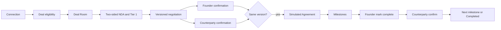

# Vault Ventures Mobile App - Deal Manager Complete Specification

**Edition:** 0.2-DRAFT
**Status:** DRAFT; documentation only; not approved or development-authorized. G-10 remains PENDING.
**Technology direction:** React Native + Expo + TypeScript mobile client; Node.js + Express.js REST backend; fresh MySQL; separate Web Admin.
**Meaning of Deal Manager:** PROPOSED module/workspace name, not a fourth global role and not an alias for Finance Manager.

---

## 0. Document Control

### 0.1 Authority

Decision Register Revision 6 is highest authority, followed by Mobile internal Edition 2.2-DRAFT, Backend 0.4-DRAFT, Admin 0.3-DRAFT, Database 0.3-DRAFT and API Contract 0.2-DRAFT. Exactly G-00, G-01 / DEC-046, OD-01 approach only, OD-03 and OD-07 are APPROVED. All other unresolved decisions remain PENDING or NEEDS VERIFICATION.

| Label | Meaning |
|---|---|
| SOURCED | Required by an active authority. |
| PROPOSED | Module, screen or design detail offered for review. |
| CONDITIONAL | Available only after its decision and migration allocation are approved. |
| PENDING | No option selected; must not be implemented as decided. |

No earlier Deal Manager document was found. This file is the sole module specification.

| Edition | Change |
|---|---|
| 0.1-DRAFT | Initial complete Deal Manager module specification. |
| 0.2-DRAFT | Resolved the Deal-list API gap through API-E-113, narrowed delegation revocation to the revoked authorization basis, and expanded all 15 screens into individual UI/UX handoff specifications. No pending decision approved. |

---

## 1. Executive Module Overview

The Deal Manager module is a PROPOSED mobile workspace that gathers authorized Deal overview, lifecycle, disclosure/NDA context, negotiation, agreement, milestones, Deal Chat, financial context, notifications and activity. It exists to make sourced Deal functions understandable and navigable without creating new authority.

Primary users are Deal Founders and counterparty Investors or Skilled Professionals. A Finance Manager participates only through accepted Business membership, explicit permissions and a current Deal-specific Founder delegation. Project Managers may receive operational milestone/task permissions. Admin is outside the module and has no default confidential Deal or message access.

Out of scope: real payments, escrow, custody, banking, legal enforcement, AI approval, Admin impersonation, automatic delegation, unapproved cancellation states, and permission escalation.

Prerequisites include authentication, relevant global role, Business/Connection context, current disclosure/NDA/tier gates, Deal eligibility, and deployed migration groups for conditional collaboration/messaging/financial features.

---

## 2. Deal Manager Role Clarification

No authoritative source defines a `Deal Manager` role. Therefore:

- It is a module/workspace label only.
- Global roles remain Founder, Investor and Skilled Professional.
- Finance Manager, Business Manager and Project Manager are Business-scoped role labels; titles alone grant nothing.
- Finance Manager is not “Deal Manager”; Finance Manager has only expressly granted Deal actions.
- Founder controls the Business and Deal delegation and alone confirms the Founder side.
- Counterparty authority is independent.
- Admin governs platform functions but is never a Deal participant through Admin authority.

Any future separately named Deal Manager role is a requirements gap and requires a new approved decision.

---

## 3. Actors and Responsibilities

| Actor | Identity/context | Responsibilities and boundaries |
|---|---|---|
| Founder | Global Founder; Business owner | Own Deal side, delegate allowed actions, propose/counter, formally confirm Founder side, define/complete milestones, own reporting authority. |
| Investor | Global Investor; Deal counterparty | Propose/counter, independently confirm agreement and milestone completion, review authorized financial data, flag discrepancy. |
| Skilled Professional | Global role; may be counterparty or member | Only counterparty rights or exact Business grants; no inferred Founder authority. |
| Finance Manager | Skilled Professional + active Business membership/role/grant/delegation | Draft/counter and communicate only for the delegated Deal/actions; never final-confirm. |
| Business Manager | Business-scoped label | Only exact resource/action grants; no automatic Deal access. |
| Project Manager | Business-scoped label | Only exact task/milestone operational grants; no automatic formal completion. |
| Restricted Custom Role | Conditional Business role | Only within later-approved ceiling and grants. |
| Platform Admin | Separate internal identity | Tier 1 verification and approved governance; no participant/Founder authority or default private Deal/message access. |

---

## 4. Complete Feature Catalogue

Each feature uses existing APIs and entities; screen IDs are defined in Section 7.

| ID | Feature and actor/action | Preconditions and outcome | API | DB | Rel/gate |
|---|---|---|---|---|---|
| DM-F-001 | Deal dashboard/list for authorized parties | Current party; safe summaries only; delegation revocation removes only that basis | E113,E052,E063,E086 | E040,E041,E051; optional E071/E076 | R1 core; delegated/message summaries PA |
| DM-F-002 | Search/filter My Deals | Authorization before selection; no cross-Business leak; core party path has no MP dependency | E113 | E040 core; optional E071/E076 | R1 core/MP1+MP2 delegated |
| DM-F-003 | Deal detail/participants | Party or exact delegation; minimized representation | E052 | E040,E076 | Core/MP2 |
| DM-F-004 | Deal creation eligibility | Connection and G-08 rules; creates initial Deal | E051 | E035,E040 | G-08 PENDING |
| DM-F-005 | Eight-state lifecycle monitoring | Server-derived state, client cannot choose target | E052,E053 | E040,E041 | R1 |
| DM-F-006 | State history/activity | Authorized ordered history | E053 | E041,E053 | R1 |
| DM-F-007 | Interest/Connection context | Party-only context | E045..E048 | E033,E035 | R1 |
| DM-F-008 | Disclosure/NDA status | Stage is server-controlled | E049,E050 | E036..E038,E007 | R1 |
| DM-F-009 | Protected Deal documents | Current stage/NDA/tier gate | E018,E024 | E017,E024,E039 | R1 |
| DM-F-010 | Delegation creation | Founder grants named member/action/Deal | E054 | E071,E076,E077 | MP1/MP2; BR-DEC-006 |
| DM-F-011 | Delegation listing/identity | Founder/delegate sees safe scope | E056 | E076,E077 | MP2 |
| DM-F-012 | Delegation revocation | Founder ends only delegation-derived authority; independent party/other valid bases are re-evaluated; history retained | E055,E113 | E040,E071,E076,E053 | MP2 |
| DM-F-013 | Proposal/counter creation | Party core or exact Finance Manager action; immutable version | E057 | E042; optional E076/E077 | R1 core/MP2 |
| DM-F-014 | Proposal history | Party/current authorized delegate | E058 | E042 | R1 |
| DM-F-015 | Founder final confirmation | Authenticated Deal Founder only, exact version | E059 | E043 | R1 |
| DM-F-016 | Counterparty confirmation | Authenticated counterparty independently | E060 | E043 | R1 |
| DM-F-017 | Simulated Agreement viewer | Both confirmations same version; read-only | E061 | E044 | R1 |
| DM-F-018 | Milestone creation/update | Founder core; conditional operational grants | E070,E071 | E046; optional E071/E074/E075 | Core/MP1/MP2 |
| DM-F-019 | Milestone tracker/history | Authorized Deal party/delegate | E072 | E046..E048 | R1 |
| DM-F-020 | Progress update/evidence | Party or exact operational grant | E073 | E048,E017 | R1/conditional grant |
| DM-F-021 | Founder mark-complete | Founder only under safe current policy | E074 | E047 | R1; delegation PENDING |
| DM-F-022 | Counterparty milestone confirm | Independent counterparty; unlock next | E075 | E047,E041 | R1 |
| DM-F-023 | Milestone dispute | Either party flags; no invented Admin resolution | E076 | E047 | R1; DEC-014 |
| DM-F-024 | Deal Chat | Current Deal/delegation or independent party basis plus NDA gates; revoked delegation cannot authorize, and cache/previews are invalidated | E062..E069 | E045,E078..E080 | MP3; MSG decisions |
| DM-F-025 | Deal notifications | Safe, reauthorized summaries | E086,E087 | E051 | R1 in-app |
| DM-F-026 | Financial report context | Authorized party/grant; immutable versions | E077..E083 | E055..E060 | R2/MP4 |
| DM-F-027 | Simulated funding/commission | Authorized read; always simulated | E084 | E054,E061,E062 | R2 |
| DM-F-028 | Audit/activity evidence | Participant-safe activity; Admin audit separate/redacted | E053,E106 | E041,E053 | R1/OD-10 |
| DM-F-029 | Error/conflict recovery | 404 privacy, 409 stale/idempotency | All mapped APIs | Transaction rules | All |
| DM-F-030 | Completion/history | Last confirmed milestone moves Deal to Completed; records retained | E072,E075,E090 | E040,E041,E047,E049 | R1 |

---

## 5. Deal Lifecycle

No Cancelled, Failed or Archived state is added.

| State | Meaning / entry evidence | Allowed work | Key errors/pending |
|---|---|---|---|
| Matched | Match/connection context; persistence trigger PENDING G-08 | View eligible context | Missing eligibility; exact creation timing PENDING |
| Interest Confirmed | Mutual interest/Connection | Disclosure workflow | Declined or unrelated participant |
| Deal Room Opened | Deal workspace created | Authorized overview/documents | Wrong Business/Deal; transition trigger PENDING |
| NDA Signed | Two accepted versioned NDA responses plus Tier 1 for Stage 3 | Protected disclosure | Missing party response/tier; no stage skip |
| Negotiation | Server-validated transition | Immutable proposals/counters | Revoked/wrong-Deal delegate; stale version |
| Agreement | Founder and counterparty confirmed same final version | Read simulated Agreement; define milestones | Delegate/Admin confirmation denied |
| Milestone Funding Active | Agreement/milestone prerequisites met | Simulated milestones, progress, reporting | Timing/funding semantics partly PENDING |
| Completed | Last milestone independently confirmed | Feedback and historical read | No automatic completion from Founder mark alone |

Every transition is server-validated, ordered in DB-E041, and audit-correlated. The client invokes domain actions rather than sending a target state.

---

## 6. Permission Matrix

`G` requires current explicit grant/delegation; `O` means owning/party authority; `-` prohibited; `P` unresolved.

| Action | Founder | Investor | Professional counterparty | Finance Mgr | Business Mgr | Project Mgr | Custom | Admin |
|---|---|---|---|---|---|---|---|---|
| View own Deal | O | O | O | G | - | G only if approved | G/P | No default |
| Create/open Deal | O/P | Counterparty context | Counterparty context | - | - | - | - | - |
| Create/counter proposal | O | O | O if counterparty | G | - | - | - | - |
| Create/revoke delegation | O | - | - | - | - | - | - | - |
| Founder final confirm | O | - | - | - | - | - | - | - |
| Counterparty final confirm | - | O | O if counterparty | - | - | - | - | - |
| Define/update milestones | O | View/party | View/party | G/P | G/P | G operational | G/P | - |
| Formal Founder complete | O | - | - | - | - | - | - | - |
| Confirm milestone | - | O if counterparty | O if counterparty | - | - | - | - | - |
| Deal Chat | O | O | O | G | - | G only if Deal-authorized | G/P | No default |
| Financial draft/edit | O | - | - | G separate | G separate/P | - | G/P | - |
| Financial submit | O | - | - | P/G separate | P/G separate | - | P | - |
| Founder attestation | O | - | - | - | - | - | - | - |
| Platform audit review | - | - | - | - | - | - | - | Authorized Admin |

Revocation is basis-specific: `G` authority ends when its delegation/grant is revoked, but independently held `O` party authority is re-evaluated rather than removed. Membership alone or an unrelated Business grant never supplies target-Deal authority.

---

## 7. Mobile Screen Inventory

All screens are PROPOSED compositions of sourced functions.

| ID | Screen | Users | Purpose | APIs |
|---|---|---|---|---|
| DM-S-001 | Deal Dashboard | Parties/delegates | Authorized summaries/actions | E113,E052,E086 |
| DM-S-002 | My Deals | Parties/delegates | Lists, filters, empty/loading states | E113 |
| DM-S-003 | Deal Details | Parties/delegates | Participants, state, context | E052 |
| DM-S-004 | Deal Timeline | Parties/delegates | Ordered state/activity | E053 |
| DM-S-005 | Disclosure & NDA | Parties | NDA responses/stage | E049,E050 |
| DM-S-006 | Deal Documents | Stage-authorized | Metadata/retrieval | E024,E018 |
| DM-S-007 | Delegation Management | Founder/delegate read | Grant/list/revoke | E054..E056 |
| DM-S-008 | Negotiation Room | Parties/delegated Finance Manager | Proposals/counters | E057,E058 |
| DM-S-009 | Proposal Detail/History | Same | Version detail and confirmation actions | E058..E060 |
| DM-S-010 | Agreement Viewer | Parties | Read-only simulated agreement | E061 |
| DM-S-011 | Milestone Tracker | Parties/authorized operators | Milestone list/status | E070..E076 |
| DM-S-012 | Milestone Detail | Same | Progress/evidence/formal actions | E071..E076 |
| DM-S-013 | Deal Messages | Authorized participants | Deal Chat/read state | E062..E069 |
| DM-S-014 | Financial Summary | Authorized parties/grants | Versions/status/discrepancy | E077..E084 |
| DM-S-015 | Deal Activity History | Authorized parties | Safe activity/audit correlation | E053,E072 |

---

## 8. UI/UX Screen Specifications

All layout/component choices below are PROPOSED. Common states: skeleton loading; authorized empty state; inline validation; retryable network state; privacy-preserving 404 for forbidden/not-found; revocation state that clears protected cache and re-evaluates independent authorization; 409 stale state that reloads before retry; success announcement and destination. All screens use accessible labels, logical focus/order, scalable text, non-color-only status, localized strings/dates and BDT formatting. Styling, typography, colors, animation and assets are deliberately unspecified.

### DM-S-001 - Deal Dashboard

- Purpose/actors/availability: role-aware Deal Rooms in progress for Founder, Investor, Professional counterparty, and conditional exact delegate; core list works without MP1/MP2.
- Entry/layout/data: active-role dashboard or Deals entry; header, state-summary cards, next-action cards, notification preview; API-E-113/E052/E086; DB-E040/E041/E051 and optional E071/E076.
- Actions/forms: open Deal or safe notification; no edit form. Server authorizes every returned summary; Finance Manager never receives confirmation actions.
- States/navigation/cache: empty “No authorized Deals”; select card to S003; pagination/network retry; revocation removes delegation-derived cards but retains independently authorized party cards after revalidation. Tests DM-TC-001/002/009/022/035; gates G-07, BR-DEC-012.

### DM-S-002 - My Deals

- Purpose/actors/availability: complete authorized Deal list for core parties and conditional delegates. Entry from dashboard/navigation.
- Layout/data: search field, state/Business/role filters, secure sort selector, paginated cards showing safe Business/counterparty summary, state and last activity; API-E-113; DB-E040 core, E071/E076 conditional.
- Forms/validation/actions: query optional bounded string; state must be one of eight; opaque cursor; open card only. Server filters before count/search/page emission.
- States/navigation/cache: no-result differs from no-access only safely; invalid filter inline; 409/tampered cursor reloads; revocation invalidates pages and re-evaluates independent party basis. Navigate to S003. Tests DM-TC-001/002/009/022/035; search semantics PROPOSED.

### DM-S-003 - Deal Details

- Purpose/actors/availability: authoritative Deal summary for named parties or conditional exact delegate.
- Entry/layout/data: S001/S002 links; state badge, participant/represented-role cards, Business, disclosure/NDA indicators, authorized tabs/actions; API-E-052; DB-E040 plus conditional E071/E076.
- Actions: open timeline, documents, negotiation, agreement, milestones, messages or finance only when authorized; no target-state form.
- States/cache: protected 404, safe partial data, revoked-basis reload; independent party rights retained. Tests TC001..004/009/010; G-08 and delegation allocation PENDING.

### DM-S-004 - Deal Timeline

- Purpose/actors: ordered state history for the same authorization as S003.
- Layout/data: chronological event list with state, safe actor summary, time and trigger; cursor pagination; API-E-053; DB-E041.
- Actions/forms: filter by allowed event category only; no mutation. Server authorizes before selection.
- States/navigation: empty only for valid newly created Deal; network retry; revoked basis clears timeline then rechecks other basis; event tap may open related authorized screen. Tests TC003/004/030; exact transitions G-08/DEC-044 PENDING.

### DM-S-005 - Disclosure & NDA

- Purpose/actors: show current stage and collect a party’s own version-bound NDA response; Founder Stage 4 action remains distinct.
- Layout/data: four-stage indicator, legal-version card, party response statuses without confidential excess, accept/decline form, Founder Stage 4 button; API-E-049/E050; DB-E007/E036/E037/E038.
- Validation: decision and legalDocumentVersionId required; expected Stage 3 for Stage 4; cannot respond for another party or skip stage.
- States/navigation: tier/NDA prerequisite explanation, duplicate 409 reload, success returns to S003/S006; cache invalidated after stage event. Tests TC005/006; DEC-016/017 PENDING details.

### DM-S-006 - Deal Documents

- Purpose/actors: safe metadata and authorized retrieval under current disclosure/NDA/tier/Deal basis.
- Layout/data: locked/available file cards with safe name/type/size/stage; retrieve action; API-E-024/E018; DB-E017/E024/E039.
- Validation/security: no raw storage URL; server reauthorizes every list/retrieval and audits access.
- States: empty authorized set, upload/retrieval errors, 404 privacy, revocation clears files/previews; independent basis rechecked. Navigate back to S003. Tests TC005/009/029; OD-05/file limits PENDING.

### DM-S-007 - Delegation Management

- Purpose/actors/availability: Founder grants/lists/revokes Finance Manager Deal actions; delegate may see safe self-scope; MP1/MP2 only.
- Layout/data: active/revoked cards, represented Business, delegate selector, action checklist, optional expiry, reason dialog; API-E-054..056; DB-E071/E076/E077.
- Validation/actions: membership, same Business/Deal and non-empty approved actions required; final confirmation never offered; revoke requires reason/version.
- States/cache: duplicate/stale 409, success refreshes S003/S002/S013; revocation invalidates only delegation-derived cache and retains history/independent party rights. Tests TC008..010/022; BR-DEC-006/009/011/012 PENDING.

### DM-S-008 - Negotiation Room

- Purpose/actors: Founder/counterparty core proposals and conditional Finance Manager draft/counter.
- Layout/data: current-version card, immutable history preview, term form and propose/counter actions; API-E-057/E058; DB-E042 plus optional E071/E076/E077.
- Fields/validation: kind required; terms object required; supersedesProposalId for counter where applicable; exact term catalogue PENDING. Server derives actor and validates grant.
- States/navigation: no proposals, field errors, 409 sequence reload, revoked delegate loses composer but party basis may remain; open S009. Tests TC007..009; DEC-006/BR-DEC-006.

### DM-S-009 - Proposal Detail/History

- Purpose/actors: inspect immutable versions and perform dedicated party confirmation.
- Layout/data: version/terms/proposer/representation/timestamps/status, comparison/history; Founder-confirm button only for authenticated Founder, counterparty-confirm only for counterparty; API-E-058..060; DB-E042/E043.
- Validation: exact proposalVersion and expectedVersion; no actor field; Finance Manager/Admin never see usable final action.
- States/navigation: stale confirmation reload, changed proposal requires new confirmations, success opens S010 when both sides match. Tests TC010..014; field list PENDING.

### DM-S-010 - Agreement Viewer

- Purpose/actors: read-only simulated Agreement for authorized parties.
- Layout/data: prominent simulation notice, exact proposal version/terms, separate confirmation timestamps/parties; API-E-061; DB-E044/E043.
- Actions/forms: no edit; download absent unless later approved. Server checks Deal access.
- States/navigation: no agreement routes back to S008; revoked delegate denied unless another basis; core party remains. Tests TC013/014/028; DEC-035 download PENDING.

### DM-S-011 - Milestone Tracker

- Purpose/actors: sequence/status overview for parties and explicitly authorized operators.
- Layout/data: milestone cards, simulated amounts, progress, locked-next indicator; create button Founder core, conditional operational actor only if approved; API-E-070/E072; DB-E046/E047/E048.
- Fields/validation: sequence, description and BDT amount required for create; no real-fund language.
- States/navigation: empty authorized setup, stale list reload, revoked operational grant removes actions but not independent party view; open S012. Tests TC015..019/028; DEC-014/BR-DEC-008.

### DM-S-012 - Milestone Detail

- Purpose/actors: update authorized operational data and expose separate formal actions.
- Layout/data: description/amount/status/progress/evidence/history; progress form content required, evidence optional; API-E-071/E073..076; DB-E046..E048/E017.
- Actions: update/progress by exact grant; Founder-only mark complete; counterparty-only confirm; either party dispute. Buttons are mutually authority-scoped.
- States: validation, upload/network, 409 stale reload, revocation removes operational controls; successful final confirm returns S011 and unlocks next/completes. Tests TC015..019; formal delegation PENDING.

### DM-S-013 - Deal Messages

- Purpose/actors/availability: Deal conversation for current parties and conditional same-Deal delegate; never Admin. MP3 required.
- Layout/data: represented-role header, paginated messages, composer, unread marker, safe participant list; API-E-062..069; DB-E045/E078/E079/E080.
- Fields/validation: nonblank text body; no formal-action or NDA controls; attachment UI absent while pending.
- States/cache: authorized empty thread, send/network retry, privacy 404, access-revoked state clears messages/previews/unread/notifications. Independent party/conversation basis is separately rechecked; unrelated grants fail. Tests TC020..024 plus TC036/039; MSG decisions PENDING.

### DM-S-014 - Financial Summary

- Purpose/actors/availability: R2 report/immutable-version and simulated-finance context for authorized parties/grants.
- Layout/data: periods, version list, derived lifecycle events, evidence metadata, discrepancy action, simulated funding/commission; API-E-077..084; DB-E054..E062.
- Forms/validation: decimal-string BDT revenue/expenses, optional cash/notes, required edit note for revision, separate submit and Founder-attest actions; no client net.
- States: no reports, validation/upload/network, version conflict reload, revoked report grant clears data but Deal-party/report policy re-evaluates separately. Admin edit absent. Tests TC025..028; BR-DEC-007/DEC-012/013.

### DM-S-015 - Deal Activity History

- Purpose/actors: participant-safe aggregate links to state and milestone histories; not raw Admin audit.
- Layout/data: filterable chronological cards from authorized E053/E072 results, request correlation where safe; DB-E041/E047/E048.
- Actions/forms: allowed category/date filters only; open originating authorized screen; no mutation or confidential payload.
- States/cache: empty, loading, retry, privacy 404, revoked basis clears activity then rechecks independent basis; stale cursor restarts page. Tests TC003/019/030/035; complete cross-domain aggregation beyond existing endpoints is a UI composition, not a new backend promise.

---

## 9. End-to-End Workflows

| ID | Workflow summary | APIs / writes | Success, failure and concurrency |
|---|---|---|---|
| DM-W-001 | Founder opens eligible Deal from Connection | E051; E035→E040/E041 | Deal created once; G-08 conflict/duplicate 409 |
| DM-W-002 | Counterparty enters Deal | E052; read E040 | Only named party; protected 404 otherwise |
| DM-W-003 | NDA/disclosure advance | E049/E050; E038 then E036/E037 | Two responses + tier; no skip; duplicate 409 |
| DM-W-004 | Founder proposes | E057; insert E042 | New version; prior immutable; sequence conflict re-read |
| DM-W-005 | Finance Manager counters | E057; validate E071/E076/E077, insert E042/audit | Same-Deal/action only; revocation/wrong Deal denied |
| DM-W-006 | Dual final confirmation | E059 then E060; E043→E044/E041 | Same version; Founder and counterparty independent |
| DM-W-007 | Milestone setup/progress | E070..E073; E046/E048 | Founder core; grants conditional; stale updates 409 |
| DM-W-008 | Milestone completion | E074 then E075; E047/E041 | Founder mark then independent confirm; next unlocks |
| DM-W-009 | Deal-linked communication | E062..E068; E078/E079/E045/E080 | Reauthorize before query/send; message no formal effect |
| DM-W-010 | Revoke delegation basis | E055; update E076/audit; reauthorize E113/E052 and conversation access | Delegation-derived proposals, messages, documents and summaries stop immediately; independent Founder/counterparty or other separately valid basis is evaluated and may remain. Unrelated Business grants do not restore Deal access; cache invalidated; history retained; post-revocation history visibility PENDING. |
| DM-W-011 | Financial reporting/review | E077..E084; E055..E060 | Immutable version/events; submit grant separate; Admin no edits |
| DM-W-012 | Complete Deal | E075/E090; E047/E041/E049 | Last counterparty confirmation moves Completed; feedback opens |

---

## 10. Deal Delegation and Negotiation

Delegation records Founder, Business, Deal, member, action allow-list, validity and revocation provenance. Exact limits remain PENDING. Proposal payloads are immutable versions. Authorization is rechecked immediately before selection and insert. Revocation removes only authority derived from that delegation and invalidates authorization-sensitive cache; it does not erase audit/proposal/message history or genuine Founder/counterparty rights. Another basis must independently pass membership, explicit grant, Deal context, disclosure/NDA/tier and conversation-access checks; an unrelated Business grant is insufficient. Historical visibility after revocation remains PENDING. A delegation cannot accept NDA, change disclosure, add participants, grant permissions or confirm either agreement side.

---

## 11. Agreement and Milestone Management

Agreement is created only after both authenticated parties confirm the same proposal version and is explicitly simulated/read-only. Milestones retain Founder authority. Operational Project Manager grants do not imply formal completion. Counterparty confirmation is a separate event; disputes do not invent an Admin adjudication workflow.

---

## 12. Deal Messaging

Deal Chat eligibility requires current independent Deal participation or explicit same-Deal delegation plus Business, disclosure, two-sided NDA and tier gates. Lists, search, previews, unread counts, notifications, reads and sends authorize before selection. Revoking a delegation blocks only access derived from it and invalidates previews, unread counts, notifications and cached pages; a named counterparty remains eligible only through separately revalidated counterparty/conversation access. Hiring, Team or unrelated Business permissions grant no Deal Chat access. Existing history is retained, while interactive historical visibility after access loss remains PENDING. Admin has no default access. Messages never accept NDA, transition state, grant permission, confirm proposals or certify milestones. Retention, deletion, attachments, receipts, presence, moderation and delivery technology remain PENDING.

---

## 13. Financial Reporting and Simulation

Finance Manager Deal delegation does not automatically grant report access or submission. Separate report view/draft/edit/submit actions are required; exact submission authority remains PENDING under BR-DEC-007. Each edit inserts DB-E056; evidence links use DB-E057; submission, Founder attestation and Admin review append DB-E058 events. Founder attestation is owner-Founder-only under the safe contract. Funding, commission and entitlements are simulated; no real-money API exists.

---

## 14. Admin vs Deal Manager

| Concern | Module participant | Platform Admin |
|---|---|---|
| Deal content | Party/current exact delegation | No default confidential access |
| Business permissions | Founder controls | Cannot grant itself or manage as member |
| Proposal/final confirmation | Parties; Founder/counterparty boundaries | Cannot propose or confirm |
| Milestones | Founder/party/explicit operator | No write; later oversight only if approved |
| Private messages | Current conversation participant | No default list/read/search/preview |
| Identity verification | Applicant submits | Admin reviews Tier 1 under OD-03 |
| Financial figures | Founder/exact member grant | Review events only; never edit/submit/attest |
| Audit | Participant-safe activity | Redacted audit search if allocated |

---

## 15. API Integration Catalogue

| Capability | API ID / method/path | Request/response and controls |
|---|---|---|
| Deal create | E051 POST `/connections/{connectionId}/deals` | Trigger context; returns deal/state; I/A; G-08 |
| Deal list/search | E113 GET `/deals` | Core party list from E040; optional conditional delegate branch after MP1/MP2; safe cursor/filter/search and basis-specific revocation |
| Detail/history | E052 GET `/deals/{dealId}`; E053 GET `/deals/{dealId}/history` | Safe summary/page; party/delegate; 404 privacy |
| Delegation | E054 POST, E055 revoke, E056 GET under `/deals/{dealId}/delegations` | Member/actions/expiry or reason/version; MP2 |
| Proposals | E057 POST; E058 GET `/deals/{dealId}/proposals` | Terms/version page; I/A; immutable |
| Confirmation | E059 Founder; E060 counterparty | proposalVersion/confirm; dedicated actor routes; I/V/A |
| Agreement | E061 GET `/deals/{dealId}/agreement` | Read-only simulated agreement |
| Milestones | E070..E076 `/deals/{dealId}/milestones...` | Versioned create/update/progress/formal actions |
| Deal Chat | E062..E069 `/conversations...` | Type-specific eligibility; MP3; authorization before query |
| Documents | E024 list; E018 retrieve | Safe metadata/binary; stage and access audit |
| Financial | E077..E084 | Immutable versions/events, discrepancy and simulated context |
| Notifications | E086/E087 | Recipient-safe page/read marker |
| Feedback | E090 | One eligible reviewer/Deal |

Resolved API gap DM-GAP-001: Edition 0.1 recorded that no dedicated paginated Deal list existed and prohibited overloading E052. API Contract 0.3 now adds API-E-113 `GET /deals`; the historical gap record is retained in Section 22 as RESOLVED, without implying implementation.

---

## 16. Database Entity Mapping

| DB ID/table | Module relationship |
|---|---|
| E033 interests; E035 connections | Pre-Deal relationship |
| E036 disclosure_relationships; E037 disclosure_stage_events; E038 nda_responses | Disclosure/NDA gates |
| E040 deals; E041 deal_state_history | Deal core and eight-state history |
| E042 negotiation_entries; E043 negotiation_confirmations; E044 agreements | Immutable negotiation and dual confirmation |
| E046 milestones; E047 milestone_events; E048 milestone_progress_updates | Milestone lifecycle |
| E049 feedback_entries; E050 reputation_events | Completion feedback/reputation |
| E051 notifications; E053 audit_log_entries | Safe events and audit |
| E054 investment terms; E055 reports; E056 versions; E057 files; E058 report events | Simulated investment/report history |
| E059 discrepancies; E060 discrepancy_events; E061 funding; E062 commission | R2 simulated finance |
| E071 memberships; E074 permission grants; E075 tasks | Conditional Business collaboration |
| E076 deal_delegations; E077 deal_delegation_actions | Deal-specific authority |
| E078 conversations; E079 participants; E045 messages; E080 read states | Unified Deal Chat |

Ownership flows from Business Founder and Deal parties. Conditional actor/delegation FKs are added only after MP1/MP2/MP4. There is no `deal_manager` table and none is required for the module label.

---

## 17. Security and Privacy

| Threat/negative case | Required control |
|---|---|
| Cross-Business ID substitution | Validate Business through Deal and membership; protected 404 |
| Role-title privilege escalation | Exact current resource/action grant; default deny |
| Wrong/revoked Deal delegation | Remove only delegation-derived authority, invalidate cache and separately evaluate any genuine party/other valid basis; unrelated grants fail |
| Founder impersonation | Actor from session; dedicated confirmation route; ignore actor input |
| Conversation probing | Authorize before list/search/count/preview; no metadata leak |
| NDA/tier bypass | Server-derived stage, both NDA responses and Tier 1 gate |
| File/storage exposure | Server-mediated retrieval; opaque ID; audit; no storage key |
| Stale proposal/milestone/report | Version/sequence uniqueness and 409 re-read |
| Replay | Idempotency key; same-key changed payload 409 |
| Audit leakage | Redact message bodies, evidence, secrets and raw financial figures |
| Admin overreach | Separate Admin identity; no participant or private-message routes |

---

## 18. Error and Concurrency Handling

Use 400 validation, 401 unauthenticated, 404 existence-hiding, 409 conflict/stale/idempotency, 423 suspended, 429 limited and 501 only for non-sensitive disabled features. Revocation races lock/recheck the authorization basis before selection/commit, invalidate basis-scoped caches and never revoke independent party authority. Proposal versions, state events, milestone actions and financial events allocate under transaction locks/unique sequence constraints. A losing concurrent writer re-reads. Multi-step confirmation never partially creates Agreement; financial/milestone actions and audit commit atomically where specified.

---

## 19. Testing Requirements

No test has run.

| ID | Scenario / expected result |
|---|---|
| DM-TC-001 | Founder/counterparty list only their Deals; unrelated ID returns protected 404. |
| DM-TC-002 | Business A membership cannot access Business B Deal. |
| DM-TC-003 | Deal shows exactly one of eight valid states; no invented state accepted. |
| DM-TC-004 | Client-supplied target state is rejected. |
| DM-TC-005 | Two-sided NDA plus Tier 1 enables Stage 3; missing condition denies. |
| DM-TC-006 | Stage 4 requires authenticated Founder confirmation. |
| DM-TC-007 | Founder/Investor proposal creates new immutable version. |
| DM-TC-008 | Finance Manager same-Deal/action delegation permits draft/counter. |
| DM-TC-009 | Wrong-Deal, expired or revoked delegation denies proposal. |
| DM-TC-010 | Finance Manager/Business Manager/Project Manager/Custom/Admin final confirmation denied. |
| DM-TC-011 | Founder route records Founder side only. |
| DM-TC-012 | Counterparty route records counterparty side only. |
| DM-TC-013 | Agreement appears only when both confirm same version. |
| DM-TC-014 | Concurrent confirmation creates one side record/agreement. |
| DM-TC-015 | Milestone create/update honors Founder core and conditional grant separation. |
| DM-TC-016 | Project Manager operational grant cannot formal-complete. |
| DM-TC-017 | Founder mark does not unlock next milestone. |
| DM-TC-018 | Counterparty confirmation unlocks next or completes last. |
| DM-TC-019 | Stale milestone version returns 409 with no partial event. |
| DM-TC-020 | Hiring/Team participation grants no Deal Chat. |
| DM-TC-021 | Deal Chat list/read/send/search reauthorize current delegation. |
| DM-TC-022 | Revocation removes preview/unread/search/message access. |
| DM-TC-023 | Admin cannot list or read private conversation. |
| DM-TC-024 | Message cannot confirm agreement/milestone or accept NDA. |
| DM-TC-025 | Financial edit creates new version; prior row unchanged. |
| DM-TC-026 | Draft/edit grant alone cannot submit or attest. |
| DM-TC-027 | Founder attestation appends event; Admin cannot attest/edit. |
| DM-TC-028 | Funding/commission responses always show simulation. |
| DM-TC-029 | Protected file response contains no storage key. |
| DM-TC-030 | Audit contains actor/context but no confidential payload. |
| DM-TC-031 | Idempotency replay returns original; changed payload conflicts. |
| DM-TC-032 | Suspended participant receives no protected Deal data. |
| DM-TC-033 | UI hides actions but server also denies forged calls. |
| DM-TC-034 | Empty/loading/error/revoked UI states clear stale confidential data. |
| DM-TC-035 | Core Founder/Investor Deal functions run without MP tables; delegated functions do not. |
| DM-TC-036 | A Finance Manager whose only basis is a revoked delegation receives no Deal list/detail/history/document/message/proposal access and no private preview, unread count or notification. |
| DM-TC-037 | A named Deal counterparty who also held a now-revoked delegation retains only independently revalidated counterparty rights; delegation-only actions disappear. |
| DM-TC-038 | A participant with an unrelated Business membership/grant receives no target-Deal summary, history, document, proposal or conversation metadata. |
| DM-TC-039 | Revocation invalidates cached API-E-113 pages and message-derived preview/unread/notification data while preserving stored audit/proposal/message history; interactive historical visibility follows the still-PENDING policy. |

---

## 20. Feature-to-API-to-Database Traceability

| Features | Requirements | Actor | Screens | APIs | DB | Gate | Tests |
|---|---|---|---|---|---|---|---|
| F001..006 | BE-DLR-001..008, BE-DSH-001/002, DLR/DSH | Parties/delegate | S001..004,S015 | E051..053,E113 | E040/E041; optional E071/E076 | G-08/BR-DEC-012 | TC001..004,TC035..039 |
| F007..009 | BE-INT, BE-DIS, BE-DOC | Parties | S005/S006 | E045..050,E018/E024 | E033,E035..E039,E017/E024 | DEC-016/017 | TC005/006/029 |
| F010..012 | BE-DLR-009..013 | Founder/delegate | S007 | E054..056,E113 | E040,E071,E076/E077 | BR-DEC-006/009/010/011/012 | TC008/009/022,TC036..039 |
| F013..017 | BE-NEG, BE-AGR | Parties/Finance Mgr | S008..010 | E057..061 | E042..E044 | BR-DEC-006 | TC007..014 |
| F018..023 | BE-MIL, BE-BIZ-016 | Founder/party/operator | S011/S012 | E070..076 | E046..E048 | DEC-014/BR-DEC-008 | TC015..019 |
| F024/025 | BE-MSG/NTF | Participants | S013 | E062..069,E086/E087 | E045,E051,E078..E080 | MSG-DEC-001..013 | TC020..024,TC036..039 |
| F026/027 | BE-FIN/INV/PAY | Founder/Investor/grantee | S014 | E077..084 | E054..E062 | BR-DEC-007, R2 | TC025..028 |
| F028..030 | BE-AUD/REP/DLR | Parties/Admin separate | S004/S015 | E053,E075,E090,E106 | E041,E047,E049,E053 | OD-10/G-07 | TC030..035 |

---

## 21. Development Handoff

### What the Deal Manager Developer Must Build

- [ ] After G-10, implement a mobile module shell that consumes only approved API contracts.
- [ ] Keep session/global role, Business membership, grant and Deal delegation distinct.
- [ ] Build S001..S015 as permission-aware views; UI hiding is never authorization.
- [ ] Integrate core party flows independently of MP1..MP4.
- [ ] Add conditional delegation/messaging/report features only when migrations and decisions are enabled.
- [ ] Use dedicated Founder and counterparty confirmation actions.
- [ ] Clear cached confidential data immediately on 401/404/423 or revocation signals.
- [ ] Preserve immutable proposal/report histories and append-only events.
- [ ] Implement safe loading, empty, conflict and privacy-preserving error states.
- [ ] Integrate reviewed API-E-113 for Deal listing; do not overload single-resource API-E-052.
- [ ] Model authorization caches by basis so revoking a delegation removes only derived results and forces independent party/grant/conversation re-evaluation.
- [ ] Implement and evidence DM-TC-001..035; do not claim results beforehand.

Recommended boundaries: `deal-overview`, `disclosure`, `delegation`, `negotiation`, `agreement`, `milestones`, `deal-messaging`, `financial-context`, and shared authorization/error adapters. Backend responsibilities remain authorization, transitions, transactions, audit and minimization. Mobile responsibilities remain presentation, input validation, request correlation and safe cache lifecycle.

Suggested sequence after authorization: core read/history → disclosure/docs → negotiation/dual confirmation → milestones → conditional delegation → conditional messaging → R2 financial context → hardening/tests.

---

## 22. Risks and Open Decisions

| ID | Risk/gap | Status/source |
|---|---|---|
| DM-R-001 | Module name mistaken for global role | Mitigate with Section 2; no source role |
| DM-R-002 | Finance Manager gains final authority | High; BR-DEC-006 pending |
| DM-R-003 | Cross-Business/Deal leakage | High; server isolation tests |
| DM-R-004 | Project Manager assignment treated as completion authority | High; BR-DEC-008/DEC-014 |
| DM-R-005 | Message treated as formal approval | High; MSG-DEC-005/006 |
| DM-R-006 | Conditional tables assumed in core release | High; G-07/BR-DEC-012/MSG-DEC-013 |
| DM-R-007 | Financial delegation conflated with submission | High; BR-DEC-007 |
| DM-R-008 | Admin oversight expands into confidential access | High; AD-DEC-03/06 |
| DM-GAP-001 | Historical: no Deal list/search API-E route in API Contract 0.2 | RESOLVED in API Contract 0.3 by API-E-113; implementation still unauthorized |
| DM-GAP-002 | Exact Deal creation/state triggers and non-completion behavior | G-08, DEC-044 PENDING |
| DM-GAP-003 | Negotiation terms/limits | DEC-006, BR-DEC-006 PENDING |
| DM-GAP-004 | Milestone structure/delegable formal actions/dispute resolution | DEC-014, BR-DEC-008 PENDING |
| DM-GAP-005 | Deal Chat participants/history/retention/attachments/delivery | DEC-010, MSG-DEC-001..013 PENDING |
| DM-GAP-006 | Financial submission/attestation delegation | BR-DEC-007 PENDING |
| DM-GAP-007 | Session/token and secure client storage | G-03/G-05/OD-08/11 PENDING |
| DM-GAP-008 | Release allocation and development authorization | G-07 and G-10 PENDING |
| DM-GAP-009 | Screen visual design, accessibility details and localization | UI decision; functionality fixed |
| DM-GAP-010 | Historical access after revocation | BR-DEC-010/MSG-DEC-010 PENDING |

There is no identified database gap for the module label itself. Conditional physical allocation remains a release blocker, not a missing entity.

---

## 23. Definition of Done

- [ ] All relevant pending decisions for the selected release resolved or explicitly deferred.
- [ ] DM-GAP-001 resolved in a reviewed API Contract.
- [ ] Selected migrations align with endpoint deployment.
- [ ] Independent security review confirms Business/Deal/message isolation.
- [ ] All applicable DM-TC cases implemented and evidenced after G-10.
- [ ] Founder/counterparty boundaries and simulation labels verified.
- [ ] Accessibility, localization and safe cache behavior reviewed.
- [ ] No feature is called implemented, tested or approved without evidence.

---

## 24. Final Document Status

This 0.2-DRAFT is a source-grounded Deal Manager module specification. “Deal Manager” is a PROPOSED workspace, not a global or Business role. It preserves all eight Deal states, Founder-only Founder-side confirmation, independent counterparty confirmation, explicit Finance Manager delegation, basis-specific revocation, operational-only Project Manager authority, private Deal Chat boundaries, immutable financial history and simulation-only finance. All BR-DEC, MSG-DEC, G-07, G-10 and other unresolved matters remain pending. No code, database, API, UI, migration or test implementation is claimed or authorized.

DEAL-MANAGER-COMPLETE-SPEC-0.2-DRAFT-END-MARKER

**END OF DOCUMENT - Deal_Manager_Complete_Specification.md**
